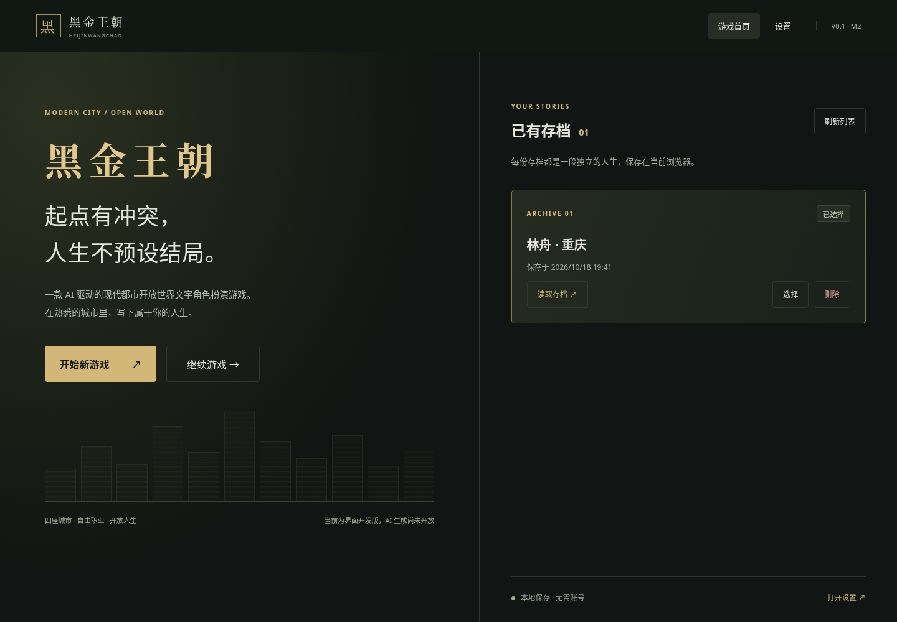
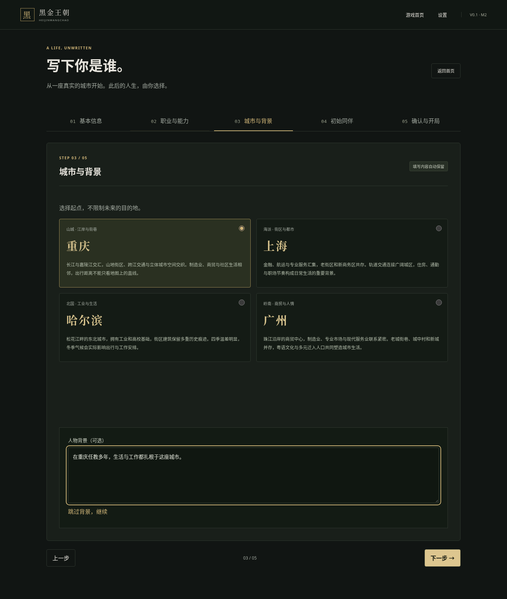
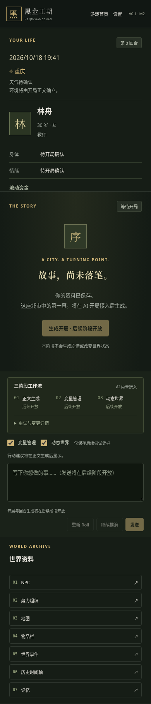

# M2 游戏界面与角色创建

从最新 `main`（`8e9de8b`）建立 `codex/m2-game-interface`。已阅读正式设计、技术计划、M0/M1 开发说明并复用现有 React / TypeScript / Zod / SaveRepository。没有修改 M1 领域 Schema、事务接口、正式 `docs/` 或原始 `prompts/`。

## 已实现的界面

- 首页：游戏介绍、开始新游戏、继续游戏、真实存档列表、最近选择、读取/切换/确认删除、设置及版本信息。存档来自 IndexedDB；删除使用原有 revision 检查与跨 store 事务。
- 五步创角：自由基本信息，正式文案的 16 职业及自定义职业，可编辑技能，四座城市与可选背景，可选特殊 NPC 同伴，完整确认及返回编辑、开局偏好。切换职业/城市和返回步骤保留填写内容，部分填写与当前步骤可在刷新后恢复。
- 三栏：左侧按规范顺序读取主角、资金与装备引用，并独立滚动；中央保存正文阅读位置，三阶段状态位于输入框上方；右侧七个纵向直接入口。手机端改为单列，中央阅读在前，七个入口仍直接纵向列出，不使用嵌套标签导航。
- 七面板：NPC 搜索及普通/特殊分组、四类组织、已知地理层级、主角物品、已知事件、按游戏时间排序的重大结案时间轴、分层记忆/来源与永久正文档案。
- 四类设置：AI 渠道/协议/密钥/模型与三阶段路由结构（禁用）；严格七项提示词偏好；即时记忆窗口；两个独立运行开关、超时及未来校验/重试区域。实际可用的偏好可保存并恢复；不收集密钥，不发送 API 请求。
- 可访问性：原生表单与 radio/checkbox、显式标签、可见焦点、原生 dialog、Tab 循环、Escape 关闭、关闭后焦点与阅读位置恢复、背景滚动锁及 reduced-motion 支持。

无 UI 组件库依赖。新增开发依赖仅为 Playwright 测试工具，页面不加载远程字体或图片。

## 组件与数据层

`App.tsx` 管理页面 hash、仓库连接和读回快照；组件不会直接修改正式状态。路由为首页、`#create` 和 `#game/<saveId>`，可刷新及使用浏览器返回。创角资料在 `creation/model.ts` 转换，经 `SpecialNpcSchema` / `GameStateSchema` 验证后，调用 M1 `createGameState()` 和 `SaveRepository.create()`。

现金/线上余额保持 `null`，物品及资产表为空，不产生武器。初始健康、情绪、天气及环境不作推断。原有存档的装备展示只解引用 M1 ID，不另存装备真值。金额由整数分格式化为元，未知值显示“未确认”。

开局偏好写入 M1 `TurnDraft.userInput`，保存为 `opening` 草稿，无正文或候选。正式创建和开局草稿保存分别使用 M1 的原子接口；若第二步失败，填写草稿保留、错误可见，重试只为同一稳定 saveId 补齐，不重复建档或覆盖已存在状态。测试包含该中断恢复场景。M2 不将这些操作称为已完成 AI 开局。

本地设置和未完成创角属于独立 UI 文档，使用 localStorage 和各自版本化 Zod Schema：`heijin.settings.v1`、`heijin.creation.v1`。最近存档选择为 `heijin.selected.v1`。坏数据和存储失败显示可理解提示，不悄悄吞掉错误或清空正式存档。创角成功后移除填写草稿；完整资料已在正式状态，开局偏好在开局草稿中。

提示词/运行设置只保存后续偏好，不修改正在执行的 M1 尝试，也不擅自调用 `startStageAttempt()`。记忆窗口只用于后续上下文和新存档初始化，已有存档不被界面直接改写。

## 可见性与兼容边界

M1 只有事件/记忆的明确可见性字段，人物、组织、位置及多数内部字段没有统一公开标记。M2 没有因此改动 Schema，而是由 `playerView()` 提供保守白名单：

- 事件仅展示 `known`；`hidden` 和 `partially_known` 均不暴露原始标题、条件或任务。部分已知事件缺少单独的公开摘要字段，暂不展示内部对象。
- 人物仅在初始同伴、在场、已有主角互动记录或玩家已知来源引用时显示；深层背景、私人知识、独立目标/任务及场外位置不传入面板。初始同伴在第 0 回合可以查看玩家自己填写的资料。
- 组织仅展示有玩家已知来源关联的名称、类别和主角关系；不展示内部描述、案件、资金或秘密任务。地图仅展示主角/公开资料关联的地点及其祖先层级。
- 记忆仅展示 `player_known`，过滤 NPC 私有及系统内部记忆；正文只取 narrative/summary，不展示变量规划。历史再次检查已完成、major、known，并按游戏日期排序。

仍需后续阶段补充更细的字段级公开契约后再扩展资料内容；不能把现在的保守面板当成完整世界百科。

另有两个 M1 必填字段的处理已明确：特殊 NPC 的 affinity 暂用中性占位 0，开局前界面显示“待开局确认”，不推断关系强度；worldClock 在创角开始时取一次当代时刻作为明确初始化锚点，确认页展示，随后固定保存，不随现实时间自动推进。同伴尚未生成实际场景，onScene=false；其初始身份仍是特殊 NPC。没有传统 RPG 属性，也没有新增玩法设置。

## 测试与运行

```bash
nvm use
npm ci
npm run dev
npm run check

# 一次性安装浏览器后，执行真实浏览器测试
npx playwright install chromium
npm run test:e2e

# 已安装系统 Chromium 的环境可显式指定
CHROMIUM_PATH=/usr/bin/chromium npm run test:e2e
```

浏览器测试使用独立的 5174 开发服务器，每项用例使用隔离上下文。UI 测试样例在 `src/tests/fixtures/ui.ts`，标题标注“界面测试存档（隔离）”，生产入口不导入、不注入模拟存档。隐私测试样例含明确的隐藏文本，验证其不会出现在七个面板中。没有测试数据混入玩家浏览器。

验收包括：全五步流程与返回修改、刷新恢复、16 职业与自定义职业、四城切换、同伴创建/跳过、真实存档与偏好恢复、多存档选择/切换/确认删除、七面板直接打开关闭、正文位置恢复、键盘焦点、未知资金/空装备、私有信息过滤、设置验证及无外部请求。`npm run check` 保留所有 M0/M1 测试。

本次结果（Node.js 24.19.0 / npm 11.9.0）：锁文件安装成功；`npm run check` 全部通过，5 个测试文件、117/117 测试（保留原 88 项，新增 29 项）、ESLint 零警告、TypeScript 检查和生产构建通过。Playwright 在 Chromium 的桌面及 Pixel 7 移动视口执行 4 类端到端场景，共 8/8 通过。截图采集额外检查 1440×1000 和 390×844，无脚本异常或横向溢出。未声称已验证 Safari、Firefox 或实体手机。

正式文档及提示词的 69 个文件逐个 SHA-256 一致，M1 领域与存档源码未变，`git diff --check` 通过。

## 文件清单

- 修改：`src/app/App.tsx`、`src/app/styles.css`、`package.json`、锁文件、`tsconfig.json`、`.gitignore`、`DEVELOPMENT.md`、`src/ui/README.md`。
- 新增：`src/ui/Dialog.tsx`，`src/ui/creation/{CreationWizard.tsx,model.ts,professions.json}`，`src/ui/game/GameScreen.tsx`，`src/ui/panels/{Panels.tsx,playerView.ts}`，`src/ui/settings/{SettingsPanel.tsx,model.ts}`，`src/services/local/documents.ts`。
- 新增测试：`src/tests/m2.test.ts`、`src/tests/fixtures/ui.ts`、`e2e/game.spec.ts`、`playwright.config.ts`。
- 交付：本文与 `screenshots/` 下首页、创角、桌面/手机游戏截图；删除被实现替代的 `src/ui/creation/.gitkeep`。

## 后续范围

生成开局、发送、重新 Roll、继续推演、连接测试及失败重试均明确禁用并标识后续开放。未接入 M3 AI/提示词组装、M4 工作流/正式回合提交、M5 压缩/检索/事件调度，未开发 M6 导入导出、历史回退或压力验收；原始历史数据的查看不等于已实现这些算法。本阶段不合并 main，不自动开始 M3。

## 截图





