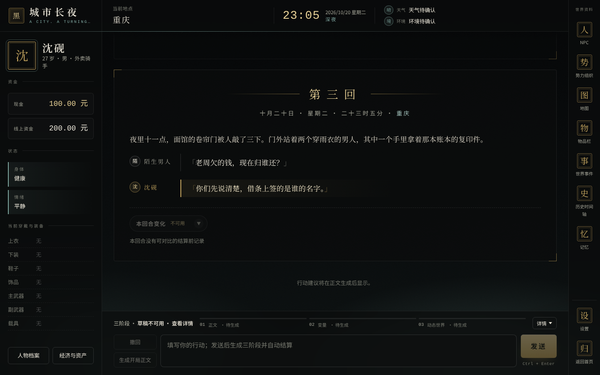
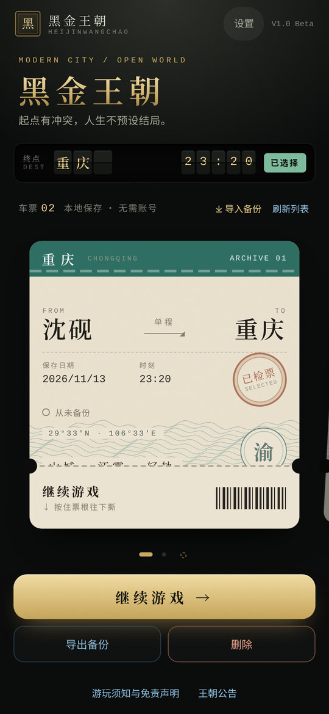
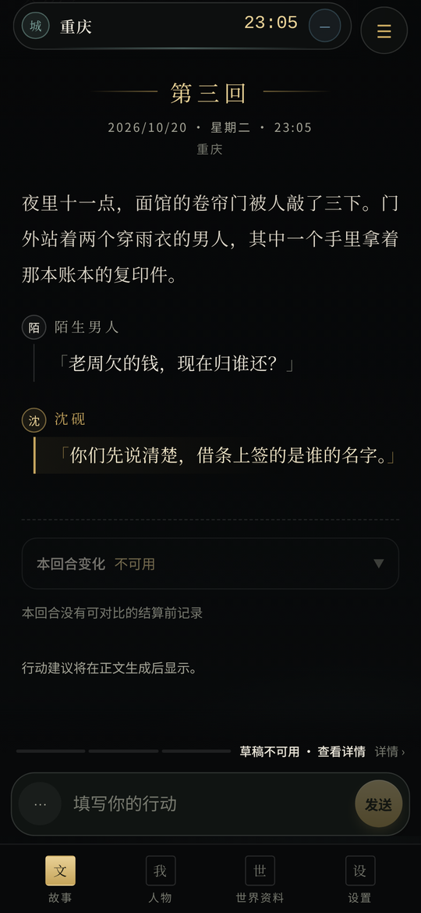
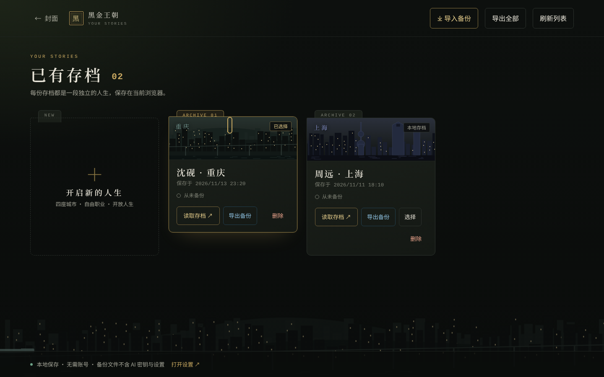

# 黑金王朝 · HeiJinWangChao

> **起点有冲突，人生不预设结局。**
>
> 一款由 AI 驱动的现代中国都市**单人开放世界文字角色扮演游戏**。在熟悉的城市里，写下属于你的人生。

**[▶ 在线试玩](https://heijinwangchao.de5.net)** ｜ 当前版本 **1.0 Beta**（预发布 [`v1.0.0-beta`](https://github.com/WJT111222/HeiJinWangChao/releases/tag/v1.0.0-beta)）｜ [更新说明](CHANGELOG.md) ｜ [后续计划](https://github.com/WJT111222/HeiJinWangChao/issues/140) ｜ **永久免费** ｜ 仅面向 18 岁及以上玩家


| 电脑端游戏界面 | 手机端车票 | 手机端阅读 |
| --- | --- | --- |
|  |  |  |

---

## 这是一款什么样的游戏？

- **自由选择人生**：以重庆、上海、哈尔滨、广州为起点，创建一个有职业、家庭、资产和社会关系的角色。工作、交友、创业、旅行、恋爱、调查，或者只是过好平凡的一天，都可以成为故事。
- **没有强制主线**：开局可以是危机、偶遇、机遇或普通的一天。游戏不会逼你犯罪、复仇或加入帮派，也不预设你一定要成为谁。
- **世界不围着你转**：NPC 和组织有自己的利益、任务、记忆和行动。世界事件随游戏时间和因果持续推进，你不在场，城市也照常运转。
- **选择会留下后果**：纠纷、约定、调查和任务都会被记录。接受、拒绝、退出或中途放弃，世界都会按实际发生的结果调整。
- **信息不等于真相**：亲眼所见、别人转述和未经证实的猜测分开记录。你能翻看世界资料，不代表你的角色就知道所有秘密。

## 快速开始

1. **打开游戏**：电脑或手机浏览器访问 **https://heijinwangchao.de5.net**，不需要注册账号。首次进入请阅读「游玩须知与免责声明」。
2. **连接 AI**：游戏本身不带 AI，需要你自备一个大模型接口。打开「设置 → AI 连接」：
   - 新建一个 **API 渠道**，选择协议：**OpenAI 兼容**、**原生 Gemini** 或 **原生 Anthropic**；
   - 填写服务地址（含版本路径的根地址）和密钥，点「保存 AI 配置」，模型列表会自动获取；
   - 为 **正文、变量、动态世界、记忆维护** 选择模型，也可以都跟随正文；
   - 想确认能用，可以点「测试连接」。这会调用一次模型，可能产生费用。
3. **创建角色**：回到首页点「开始新游戏」，按五步完成创角：基本信息、职业与能力、城市与背景、初始同伴、确认与开局。常用的设定可以「保存为开局包」，下次直接「套用开局包」。
4. **开始游玩**：在输入框写下你想做的事，点「发送」。每个回合会依次完成「正文 → 变量 → 动态世界」三个阶段，全部通过后自动结算，然后等你下一次行动。
5. **记得备份**：在存档馆（电脑）或车票（手机）上点「导出备份」，见下方[存档与备份](#存档与备份)。

## 游玩指南

### 一个回合是怎么进行的

```text
你写下行动
    ↓
正文（Story）    ：AI 写出这一回合发生的事
    ↓
变量（Variables）：把剧情里确实发生的变化整理成数据，比如金钱、物品、关系、位置
    ↓
动态世界（World）：推进你不在场的 NPC、组织和世界事件
    ↓
三阶段都通过校验 → 一次性写入存档 → 等你下一次行动
```

- 任何一个阶段失败，存档都不会被写一半。可以重试，也可以修改行动后重新发送。
- 游戏不会替你接受邀请、付款、签字或做重大决定，也不会自动帮你玩下一回合。
- 结算后可以展开「本回合变化」，看这一回合金钱、物品、关系等具体变了什么。
- 「撤回」可以退回到之前已结算的回合，每份存档最多保留 5 个恢复点。

### 界面一览

| 位置 | 内容 |
| --- | --- |
| 左侧（手机：「人物」） | 主角身份、现金与线上资金、身体和情绪状态、穿戴装备、人物档案、经济与资产 |
| 中间（手机：「故事」） | 正文阅读、角色对话、本回合变化、行动输入与三阶段进度 |
| 右侧（手机：「世界资料」） | NPC、势力组织、地图、物品栏、世界事件、历史时间轴、记忆 |
| 设置 | AI 连接、提示词（叙事人称、风格与开关）、记忆、运行、提示词管理 |

资料档案只读：翻看资料不会推进时间，不会让角色「知道」任何事，也不会发出 AI 请求。

### 存档与备份

- 存档保存在**当前浏览器**里（IndexedDB），不上传到任何服务器，也不需要账号。可以同时保留多份存档。
- **清除网站数据、卸载浏览器或更换设备都会丢失存档**，请定期导出备份：
  - **电脑**：首页进入「存档馆」，在存档卡上点「导出备份」，或在顶部点「导出全部」；
  - **手机**：在车票下方点「导出备份」，支持的浏览器还可以直接分享到聊天软件或网盘。
- 换浏览器或换手机时，点「导入备份」并选择文件即可。如果会覆盖本机已有的存档，会先列出两边的回合数和保存时间，让你确认。
- 存档馆和车票上会显示每份存档的备份状态。玩了一段时间还没备份过的存档，会有提醒。
- 备份文件**不含** AI 密钥、渠道和设置，可以放心分享给别人帮你排查问题。



### 费用与隐私

- 游戏本身永久免费。AI 生成的费用由你选择的模型服务商收取，与本游戏无关。
- 每个回合通常会调用多次模型（正文、变量、动态世界，以及按设置触发的记忆整理）。开始前请确认服务商的计费方式和用量上限。
- API 密钥只保存在你自己的浏览器里，游戏不会把它发送到你配置的模型服务以外的任何地方。
- 你的剧情内容会发送给你选择的模型服务商，请留意对方的数据政策。
- 浏览器直接连接模型服务时，需要对方允许跨域请求（CORS）。部分服务地址可能无法直接使用。

## 当前状态：1.0 Beta

1.0 Beta 是面向社区公开试玩的测试版本，主要功能已经完整。这一阶段主要想收集三类反馈：

1. **真实模型长篇游玩**：连续多回合下，NPC 关系、记忆、经济和世界事件是否连贯；
2. **各家接口兼容**：不同服务商、不同模型能否稳定通过三个阶段；
3. **手机真机体验**：iOS Safari、Android 浏览器、软键盘、小屏幕和低配设备。

**遇到问题，欢迎到 [Issues](https://github.com/WJT111222/HeiJinWangChao/issues) 反馈**。最好写清楚：电脑还是手机、浏览器、用的模型、第几回合、出了什么问题，附上截图；如果方便，再附上一份**存档备份文件**，可以原样复现你的情况。

已知限制：

- 存档只在当前浏览器里，没有云同步。
- 自动测试以模拟 AI 和 Chromium 浏览器为主，不等于所有模型、所有设备都已验收。
- AI 偶尔会输出不合格式的内容，这时该阶段会失败并提示重试，不会写坏存档。

更新内容见 [CHANGELOG](CHANGELOG.md)，后续计划见 [#140](https://github.com/WJT111222/HeiJinWangChao/issues/140)。

---

## 开发者

### 本地运行

需要 **Node.js 24** 和 npm：

```bash
git clone https://github.com/WJT111222/HeiJinWangChao.git
cd HeiJinWangChao
npm ci
npm run dev
```

开发服务默认在 `http://localhost:5173`。

### 常用命令

| 命令 | 作用 |
| --- | --- |
| `npm run dev` | 启动开发服务 |
| `npm run check` | ESLint + Vitest 单元测试 + 类型检查与生产构建 |
| `npm run test` | 只跑 Vitest |
| `npm run test:e2e` | Playwright 浏览器测试（需事先安装浏览器） |
| `npm run prompts:check` | 提示词清单与运行时检查 |
| `npm run prompts:refresh` | 修改提示词资源后刷新元数据 |

测试主要使用**模拟 AI**，用来保证结构、事务和界面正确；它不能证明真实模型一定遵守输出格式。

### 技术栈

React 19 · TypeScript · Vite · Zod · IndexedDB · Vitest · Playwright。线上部署在 Cloudflare（`wrangler.jsonc`、`src/worker.ts`），公告读取 Cloudflare KV。

### 目录结构

```text
src/
  app/         应用入口与路由
  domain/      游戏状态 Schema 与领域规则（NPC、组织、事件、经济、物品、记忆、历史）
  executors/   变量文本命令的编译与执行
  workflows/   三阶段回合、开局、记忆维护等工作流
  prompts/     运行时提示词组装与上下文预算
  services/    AI 接口、本地存储与备份、校验、公告
  ui/          界面：首页、创角、游戏、资料档案、设置
  tests/       Vitest 单元测试
prompts/       提示词资源库（阶段、世界书、写作、记忆等）
e2e/           Playwright 浏览器测试
announcements/ 王朝公告（合并到 main 后自动发布）
docs/          设计、实施与验收文档
```

### 版本号说明

几个「版本」互相独立：

| 名称 | 当前值 | 说明 |
| --- | --- | --- |
| 产品版本 | `1.0.0-beta` | `package.json`；界面显示 `V1.0 Beta` |
| 存档结构 | `GameState` Schema **V9** | 可读取 V6～V9 并自动迁移，不支持 V1～V5 |
| 本地数据库 | IndexedDB **4** | 升级后，请刷新还开着的旧版游戏标签页 |
| 备份文件 | **v1** | 不含密钥与设置 |

### 文档

- [文档索引](docs/README.md)
- [当前架构](docs/CURRENT_ARCHITECTURE.md)
- [世界事件生命周期](docs/WORLD_EVENT_LIFECYCLE.md)
- [记忆总结 V2](docs/MEMORY_SUMMARY_V2.md) ／ [多回合撤回](docs/MULTI_TURN_UNDO_V1.md) ／ [历史时间轴 V2](docs/HISTORY_TIMELINE_V2.md)
- [远程公告的发布流程](docs/REMOTE_ANNOUNCEMENTS.md)
- [运行中的提示词结构](src/prompts/README.md) ／ [提示词资源库](prompts/docs/README.md)
- [第三方来源与许可](THIRD_PARTY_NOTICES.md)
- 各阶段开发报告保留在仓库根目录与 `docs/` 下，仅供追溯；当前行为以最新代码为准。

## 关于本项目

《黑金王朝》是一个独立的个人学习与技术探索项目，也为未来的《浮生境》积累经验，**两者不是同一个软件**。《黑金王朝》《浮生境》及其官方 DLC／官方世界包**永久免费**。

---

*《黑金王朝》想要的不是一条预写好的成功之路，而是一座会记住你做过什么、也不会因为你没出现就停止运转的城市。*
