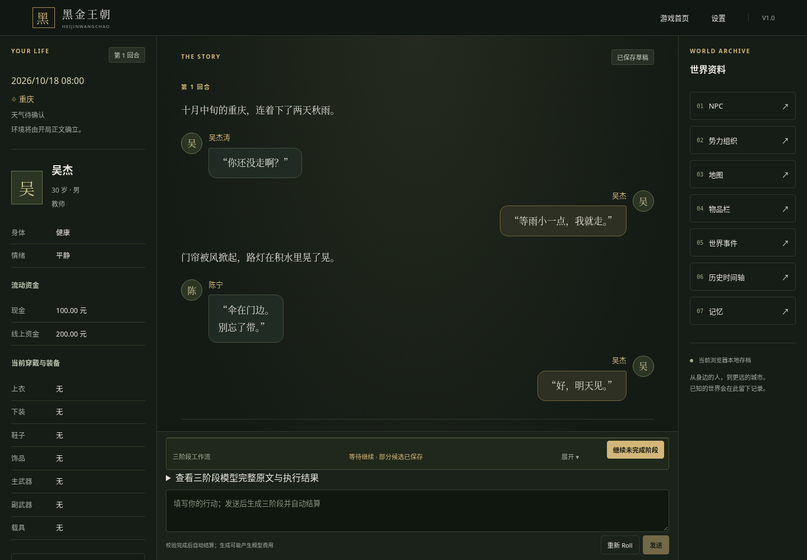
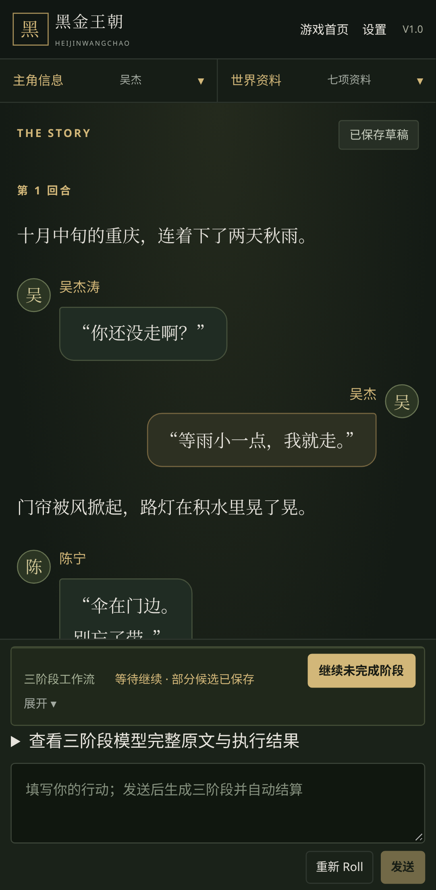

# 正文标签隐藏与人物头像气泡

## 基线与范围

基线：`main@4167b5fbe7bca5a5451b926e36747558189a4366`（PR #60 已合并）。分支：`codex/story-dialogue-reading`。

原先游戏阅读区将历史正文与当前 Story 草稿直接放进 `.prose`，因此玩家能看到所有 `【旁白】`、`【人物姓名】` 标签。本次仅替换这两处展示，流式预览继续使用原文本；完成后自然切换到共同的 `StoryReading` 组件。

## 展示规则

- 纯函数 `parseStoryReading(narrative, protagonistName)` 只识别行首（允许缩进）的完整标签；旁白按小说排版，人物发言保留姓名并显示气泡。
- 主角身份严格匹配完整 `GameState.protagonist.name`。例如主角“吴杰”的发言靠右，“吴杰涛”靠左；别名或姓名前后缀不会自动关联。
- 标签可独占一行，内容可以跨行；连续旁白、多个角色和重复发言均保持原始顺序。不要求说话人已在 NPC 表建档。
- 段内 `【…】` 保留为字面内容，不尝试猜测是否是另一个说话人。无标签、损坏标签、空标签和只有标签没有内容的片段按原文回退，不丢字、不执行 HTML。
- 没有额外身份解析或对文本的事实判断。非标准同一行多标签不会自动拆成多个气泡；这是有限展示语法的边界。
- 复用已有 `.avatar` 的颜色与文字样式，新增局部圆形样式，显示姓名首个 Unicode 字符。头像不重复进入读屏信息，完整姓名作为可读文字展示。
- 桌面气泡最大宽度 90%，窄屏使用可用宽度；长名字和长文本可换行，保持现有正文独立滚动与行动输入区。

## 原文与游戏数据边界

解析器只返回用于渲染的段落，不写存档、不生成命令、不调用网络。`Story.narrative`、journal、草稿、完整模型原文查看、历史原文档案及 Variables/World 的 `STORY_RESULT` 保留原始标签和换行。气泡只处理展示边缘空白，正文内部的标点、引号和换行保留。

未修改 Prompt、阶段协议、Schema、API 路由、时间、角色知识、记忆、自动结算和产品版本。没有新增付费或隐式请求。

## 文件

| 文件 | 用途 |
| --- | --- |
| `src/ui/game/storyReading.ts` | 只读标签分段与完整姓名判定 |
| `src/ui/game/StoryReading.tsx` | 共用小说／头像气泡展示 |
| `src/ui/game/GameScreen.tsx` | 历史和已完成草稿两处接入 |
| `src/app/styles.css` | 局部黑金气泡与移动样式 |
| `src/tests/story-reading.test.ts` | 13 项纯函数回归 |
| `e2e/story-reading.spec.ts` | 4 个场景 × desktop/mobile，共 8 项新增浏览器测试 |
| `e2e/story-runtime.spec.ts` | 既有阅读区预期更新为隐藏标签，增加原始存储断言；所有原有场景保留 |
| `docs/screenshots/story-reading-desktop.png` | 实际 Chromium 桌面截图 |
| `docs/screenshots/story-reading-mobile.png` | 实际 Chromium Pixel 7 模拟截图 |

## 验证内容与修复记录

新增单元测试覆盖标签分段、顺序、跨行／CRLF、姓名重叠、别名、未知人物、段内标签、坏格式、HTML 字面文本及输入不变性。

新增浏览器测试通过真实存储仓库创建历史／草稿并重载，检查左右几何位置、完整姓名、内容顺序与 IndexedDB 数据不变；320、390、820 CSS 像素下检查滚动、输入可达和横向溢出。另一个本地 SSE Mock 场景完整执行 Story → Variables → World → 自动 Commit：流式标签仍可见，完成后切换排版，两个下游请求中的原始 narrative 与输入严格相等，原文面板保留完整模型回复，刷新不新增请求。

开发期首次新增浏览器批次 6 通过、2 失败：普通文字回退时使用 `trim()`，使损坏标签前的换行消失。修复为回退段原样渲染，没有放松断言；复测 8/8 通过。单元定向 13/13 通过。该问题仅存在于开发过程的展示层。

最终代码冻结后的工程检查及相关浏览器回归结果见下表（不以开发期结果代替）。所有 AI 响应均为 Mock，无真实付费调用。

| 检查 | 本次实际结果 |
| --- | --- |
| `npm run check` | 69 个文件、2176/2176 工程测试通过（原有 2163 + 新增 13）；Lint、TypeScript、Vite 生产构建通过 |
| `npm run prompts:check` | 3 个文件、82/82 通过（属于工程测试中的提示词子集，不重复累加） |
| 相关 Chromium desktop | 31 通过、0 失败、0 跳过 |
| 相关 Chromium mobile | 31 通过、0 失败、0 跳过 |
| 浏览器最终批次 | 62/62 通过，约 4 分钟；包含 54 项既有回归和 8 项新增测试 |
| `git diff --check` | 通过 |

最终浏览器命令：

```sh
CHROMIUM_PATH=/usr/bin/chromium npx playwright test e2e/story-reading.spec.ts e2e/story-runtime.spec.ts e2e/game-window.spec.ts e2e/automatic-settlement.spec.ts e2e/continuous-turns.spec.ts --project=desktop --project=mobile
```

此次按 UI 影响范围执行相关浏览器回归，没有重复跑全仓库 E2E。覆盖十回合连续游玩、旧草稿、取消与重 Roll、跨标签提交、失败恢复、原文展示、独立滚动和模拟软键盘。最终验证对应代码提交 `bdcdfe3a2d223eba2d43ae6d21d0ea1d62cf0492`；随后仅补充本报告，运行代码、测试和截图不再变动。构建仍提示大于 500 kB 的分块警告，本轮未扩展为构建优化。

## 实际截图

桌面 1440 × 1000 CSS 像素；移动端采用项目 Pixel 7 配置。截图使用固定虚构测试正文与本地 Mock 存档。移动端下方被阅读区边界截住的内容可以独立滚动查看，输入区保持可达。





## 验证限制

未调用真实模型，也未在实体手机、Safari 或 Firefox 上测试；截图和移动验证属于 Chromium 设备模拟。此次只覆盖主游戏阅读区，不改变供玩家查看原始资料的档案与诊断文本。没有头像图片字段，使用姓名占位图，不增加外部资源。

完成后保留 Draft，由用户审查；不主动部署生产环境。
