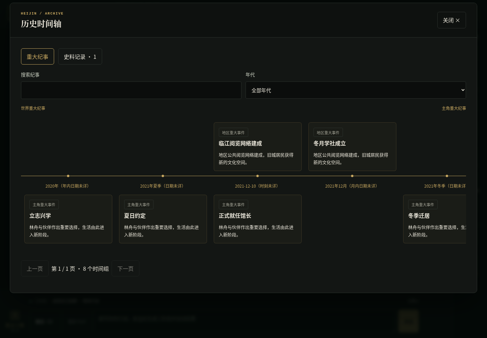
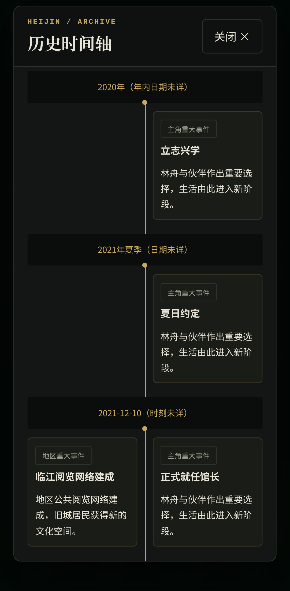
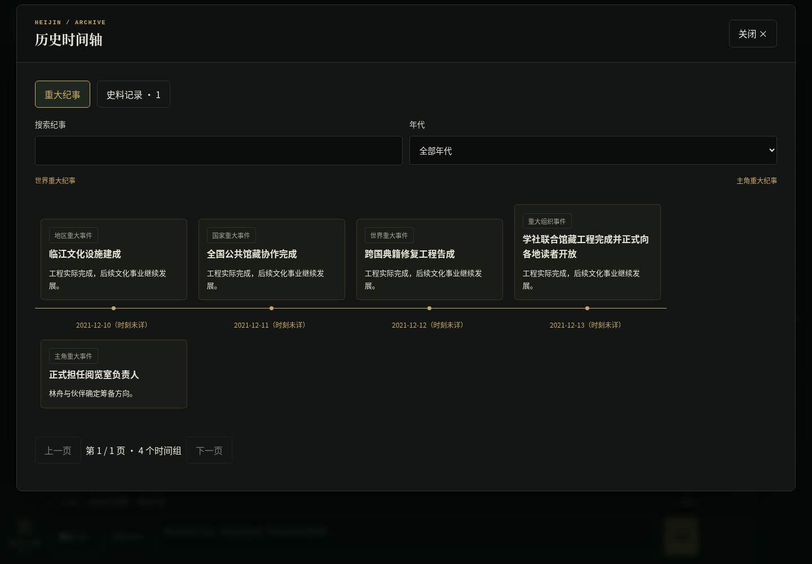
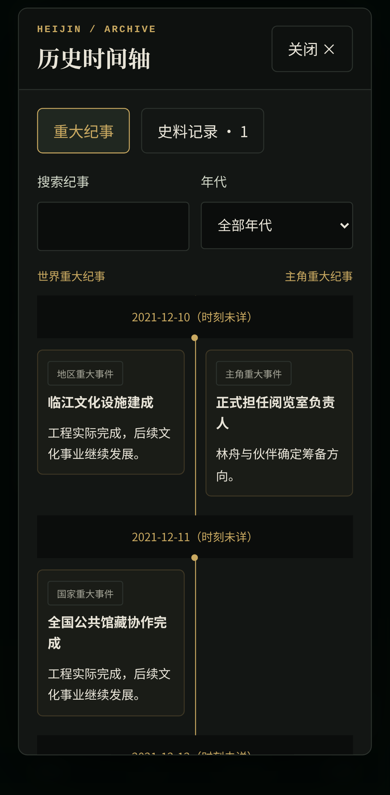

# 历史时间轴 V2 开发报告

基线 main `01f68ba0aa43f8c852b44a87318cdf01d10f4a3c`。采用已审查研究方案 B。独立分支 `feat/history-timeline-v2`；仅 Mock 与合成存档，不修改玩家存档、不增加模型请求。实现与验证结果如下。

## 实施边界

保留 RecordHistory、GameState.timeline、V6、原 World 一次请求与正式 Commit。新增可选 chronicle；普通史料的创建、纯过去视角、合法旧候选不变。重大性由 World 判断，程序没有金额、impact、词语或文学内容分类器。状态验证仅检查时间、稳定 ID、引用、枚举一致性、字段长度及终态。

- `domain/history/schema.ts`：世界/主角类别、世界影响范围、重大事实 ID、纪事正文、经过、结果、影响、四种信息性质、来源与关联。
- `domain/history/time.ts`：真实精度与只读排序键分离，未知日期不被补造。
- `domain/history/validation.ts`：整批最终 GameState 投影校验，不受 worldCommands 先于 eventCommands 的数组顺序影响。
- `domain/history/projection.ts`：先统一排序/分组再分侧；12 个时间组分页。
- `ui/panels/HistoryPanel.tsx`：PC 横向上下、手机纵向左右，共用同一槽位；普通史料独立入口、年代/搜索、详情、关联导航。

## 时间与归档

世界 event_result 关联实际终态，按事件 startAt 定位、resolvedAt 展示实际结束。未开始即取消不能当事件结果；cancellation_decision 可按实际取消时刻形成独立事实。没有正式事件实体的已结束往事用 historical_event，保留模糊时间。主角纪事于实际重大事实发生时追加。新发展、更正通过新 ID 和 follows/corrects/parallel 关联，不能修改旧纪事。milestoneId标识本次重大事实；更正发现和后续发展使用新的milestoneId，原事件ID仍可作关联，只有同一事实的两种视角共享milestoneId。

显示排序采用北京时间：精确时刻 → 同日仅日期 → 同月仅月份 → 季节末组 → 全年模糊。春/夏/秋的显示尾月为 5/8/11；冬季明确只属于所标年份，位于该年 12 月精确/月份记录后、全年模糊记录前，绝不延至下一年。季节显示键不成为事实日期。复审返修后，合法性比较采用春3–5月、夏6–8月、秋9–11月、冬当年12月的可能区间；这些边界仅在内存中比较，绝不写为 occurredAt、世界时钟或事件实际日期。区间相交时不强判真实先后，详见末尾返修记录。

范围是发生时段不详的区间，放在终点精度组之后，并完整显示两端精度。事件已知实际开始/结束则分别提供 time/endTime，不把事件持续区间当范围来改变开始定位。范围重叠仅为确定性展示次序，不声称真实先后。未知年份列于时间待考，不同重大事实各自保留位置；同一milestoneId的双视角仍共用位置。相同时刻按真实时刻（不同ISO时区可同刻）共组；同日/月/季/年共组只代表相同已知精度，不声称同时发生。组内以记录时间、ID稳定排序，不互相覆盖。

## 兼容与事务

新程序读取不含 chronicle 的旧 V6 和旧候选。未改 schemaVersion、迁移或 IndexedDB。旧程序使用严格 Schema，**不能读取写入 chronicle 后的新档/候选/完整撤回快照**。这是明确的单向前向兼容限制：发布后应使用新客户端，不得承诺降级可读，不自动删除新字段或升级旧史料；回退部署不能作为无损存档回退方式。旧客户端解析失败仍沿现有无法读取记录的导出路径保留原始数据。

同轮 SaveEvent + RecordHistory 在最终投影验证；Variables 已合法结案的现场事件由 World 直接引用，不重复终态写入。归档不清理事件、不消费主角入场、不结算后继；后续调查仍使用正常任务与新事件。记录不会向主角或 NPC 传播知识。

PR #83 的完整回合前快照包含整个 timeline，新字段自然进入同一原子 Commit/撤回事务。撤回恢复此前数组及其关系，消费快照，旧候选/回执不得复活。五回合与64 MiB限额、epoch、CAS和单一时间线均未修改。

## 提示词

真正加载的 shared.08_world_output、opening/regular.world、COMMAND_CATALOG，以及官方/企业 offscreen 模块同步新契约，Manifest 重算。原 memory.timeline_entry 未接入，未增加分类模型请求。自然语言重大性与合理性仍由 World 负责。

长度上限：标题120、摘要600、纪事3000字符；经过至多8×300，结果/影响各至多6×400；来源至多40，关系至多32。无最低篇幅或事件数量要求。长文不因UI分页而免于存档、快照或上下文成本。

## 分批验证记录

- 首轮新领域测试：30通过/1失败；旧 JSON 兼容夹具错误地携带 undefined 字段，修正为真实 JSON 序列化读取后通过。
- 领域与 World/生命周期/Commit/撤回定向批次：160通过/0失败/0跳过。
- 新 Runtime 批次首跑：32通过/3失败；两处测试误用 Composer 返回字段 records（实际 modules），一处合成事件来源回合不属于实际草稿。纠正夹具与测试后，Runtime单文件4通过/0失败。未放宽生产规则。
- 浏览器首轮沙箱启动失败：0项执行；本地服务需要执行环境权限，之后重新运行真实 Chromium。

## 实际接线与自查


- `HistoryRecordSchema.chronicle` 可选；旧普通记录不承担新的重大纪事要求。四种信息性质通过 chronicle.nature 区分；与旧 knowledgeKind 的枚举映射一致性属于结构检查，不做文本真伪判断。
- 归档验证位于 `GameStateSchema.superRefine`，命令全部应用后的最终状态可看见同批 SaveEvent 结案。没有修改 `projectTurn`、`commitCommands`、`SaveRepository` 或 World 权限检查。
- 历史 ID 查找和关系图检查使用 Map/Set，因果环检测为迭代拓扑处理，不递归遍历长链。默认每页12个时间组；同组每侧3条再分页，避免同刻大量记录一次挂载。详情展示完整保存的纪事，不以卡片摘要代替正文。
- 重大纪事同时提供精确occurredAt时，结构化time必须表示相同精确时刻，不允许降为月份/季节后改变排序；普通史料入口、信息性质与来源均保留；未知年份不伪造日期，原始 occurredTimeText/time.text 可在详情查看。
- 未改 Story/Variables 解析、模型路由、NPC 记忆、自动总结、召回算法、正式时钟、任务/事件调度、撤回策略或产品版本。没有新语义审查、额外模型调用、隐式旧档重写。
- World 模块之外仅修正官方/企业 offscreen 中与现行“玩家全量只读、角色不自动知晓”相冲突的陈旧提示；保留其组织写入权限。所有提示词更新记录在 Manifest 和 sources.lock 的 `historyTimelineV2`，保留历史来源哈希。

## 剩余边界

1. Mock 验证结构、流程和界面，不证明真实模型能够稳定认定历史重大性、辨别传闻或写出高质量纪事；这些判断没有交给程序关键词规则。
2. 新客户端向后读旧 V6；旧严格客户端不能向前读新字段。发布/回退时必须保留新格式读取能力，原始导出不等于能在旧版继续游玩。
3. 季节、月份、年份与范围尾部排序是明确的显示约定；未知精度下无法推断真实先后，UI保留“未详”标记。世界已有事件要求实际开始/结束精确匹配，不能用模糊时间掩盖冲突。
4. 单条纪事虽有上限，正式历史总量仍会增长。分页只控制DOM；全部正式历史继续进入现有上下文与完整快照。未新增压缩、截断、后台归档或预算UI。
5. 既有事件被历史引用时仍受原清理规则保护。归档不自动删事件，也不自动制造后继；任务与新事件按原流程继续。

## 合成容量与耗时测量

可复现命令：`HISTORY_MEASUREMENTS=/tmp/history-metrics.json npx vitest run src/tests/history-capacity.test.ts`。原始结果见 [history-timeline-v2.json](measurements/history-timeline-v2.json)。Node 24.19.0；每条正文400个中文字符、完整纪事结构及线性前序引用，均为虚构数据，非真实玩家存档。下表是JSON UTF-8字节，不是浏览器物理配额；耗时为此次环境一次采样（当时有并行测试负载），不是性能承诺。

|重大节点|正式状态字节|一份完整快照字节|五份同规模快照字节|结构校验ms|统一排序ms|
|---:|---:|---:|---:|---:|---:|
|0|1,602|1,950|9,750|0.46|0.11|
|100|181,915|191,253|956,265|8.73|0.65|
|1000|1,808,214|1,898,552|9,492,760|23.00|2.06|
|5000|9,048,213|9,498,551|47,492,755|93.17|5.59|

快照计量复用正式 `turnUndo.ts` 的JSON包裹形状（包含转义后的stateJSON），五份同规模乘积用于容量对照，不冒充已经在真实浏览器写入了五份大型快照。实际双端浏览器有正式Commit、撤回与重载用例；64 MiB和5回合策略不变。

|节点|阶段|最终消息字符|消息内容字节|启发式Token估算|组装ms|
|---:|---|---:|---:|---:|---:|
|0|story|34,421|82,159|38,449|27.19|
|0|variables|71,979|103,779|37,872|19.81|
|0|world|102,872|139,622|48,689|14.21|
|100|story|125,934|262,472|116,827|11.88|
|100|variables|163,492|284,092|116,251|15.28|
|100|world|285,898|500,248|205,446|17.98|
|1000|story|953,033|1,888,771|823,102|36.88|
|1000|variables|990,591|1,910,391|822,525|43.83|
|1000|world|1,940,096|3,752,846|1,617,995|98.03|
|5000|story|4,641,032|9,128,770|3,965,102|144.00|
|5000|variables|4,678,590|9,150,390|3,964,525|181.89|
|5000|world|9,316,094|18,232,844|7,901,995|348.92|

这些是实际 `composePrompt()` messages 测量；Token为现有启发式估算，不是供应商计费，未发出模型请求。World既有SAVE_STATE和专项历史容器重复传输，故增长约为另两阶段的两倍。大规模历史的请求体增长显著，可能超出供应商窗口；本轮不擅自修改完整世界读取、做隐式截断或自动换模型。

5,000条400字样本已有约9.05 MB正式状态、47.49 MB五份快照，尚未计入长期NPC记忆、大量永久正文等其他世界增长。更长纪事会更早触及64 MiB撤回预算，导致可撤回数量小于5；既有预算策略会明确报告可用记录数，不删除正式历史、不放松验证。后续如要精简上下文，应单独审查专项重复容器或有据检索，不能把本次UI分页当成Token优化。

## 截图与修改清单

以下均由实际React界面、Chromium和合成正式存档拍摄，未使用静态设计图。桌面1440×1000；手机使用仓库Pixel 7配置。





完整截图：[桌面详情](assets/history-timeline-v2/desktop-detail.png)、[手机起始视图](assets/history-timeline-v2/mobile-timeline.png)、[手机详情](assets/history-timeline-v2/mobile-detail.png)。

|范围|实际文件|
|---|---|
|协议与领域|`src/domain/history/{schema,time,validation,projection}.ts`、`src/domain/events/schema.ts`、`src/domain/state.ts`|
|World目录与诊断|`src/services/validation/{commandCatalog,worldDiagnostics}.ts`|
|展示|`src/ui/panels/HistoryPanel.tsx`、`Panels.tsx`、`src/ui/game/GameScreen.tsx`（仅弹窗样式类）、`src/app/styles.css`|
|实际提示词|`prompts/shared/08_world_output.md`、`stages/{opening,regular}/world.md`、`variableGroups/{org_business,org_government}/offscreen.md`、`manifest.json`、`sources.lock.json`|
|测试|`src/tests/history-{time,chronicle,runtime,capacity}.test.ts`、`src/tests/fixtures/historyV2.ts`、`src/tests/prompts.test.ts`（新溯源哈希）、`e2e/history-timeline-v2.spec.ts`|
|报告与证据|本报告、`docs/WORLD_EVENT_LIFECYCLE.md`、`docs/measurements/history-timeline-v2.json`、`docs/assets/history-timeline-v2/`|

大规模覆盖口径：10,000节点确定性排序；0/100/1,000/5,000节点结构引用校验与实际上下文测量；浏览器包含80条同刻长纪事的有界分页及32条额外节点的跨页搜索、后补插入。未宣称完成真实玩家5,000节点的浏览器性能测试。

## 首轮最终验收结果（审查基线 2ff555e）

实现冻结提交：`50ab9748e8e0e3d224ffff3e11da55d145723138`。后续提交仅更新本报告和本批测量结果；运行代码与测试不再改动。模型网络全部为 Mock，没有真实付费请求。

|验证批次|通过|失败|跳过|说明|
|---|---:|---:|---:|---|
|首次新领域测试|30|1|0|旧JSON夹具的undefined字段问题，已纠正|
|领域/World/Commit/撤回定向批次|160|0|0|UI开发前验证最终投影及原事务|
|新增Runtime集成首次批次|32|3|0|Composer返回值测试名和合成来源ID问题，均修正测试夹具|
|Runtime修正复测|4|0|0|真实WorldStage→Runtime→Mock→候选→Commit→重载|
|新UI首轮（桌面+手机）|2|2|0|手机双弹窗定位、刷新未等待页面就绪；修正测试操作|
|新UI增加长文场景后|4|2|0|同组排序是ID字典序，测试却期望数字序；夹具ID改零填充，不改产品排序|
|提示词审计首次|90|1|0|新增提示词未登记当前来源哈希；补historyTimelineV2并保留旧来源记录|
|完整Vitest第一批|2709|0|0|含首次历史专项与其余工程回归|
|历史专项最终|42|0|0|含精确occurredAt不能被模糊time降级的新回归|
|**完整Vitest最终**|**2710**|**0**|**0**|冻结实现，全部工程测试|
|**提示词最终**|**91**|**0**|**0**|Manifest、来源锁及真实Composer一致|
|受影响浏览器第一整批|77|1|0|桌面38/39、手机39/39；旧总结用例总时限耗尽|
|旧总结文件原样单独复跑|8|0|0|桌面4、手机4，不修改断言或超时|
|**受影响浏览器最终整批**|**78**|**0**|**0**|**桌面39、手机39；无重试；326秒**|

浏览器第一整批唯一失败是旧 `undo-summary-recovery.spec.ts` 的公共总结恢复用例。Trace中最后一次poll仅剩约380ms，整例达到30秒上限，未观察到非法写入或历史破坏。原文件独立复跑通过；最终整批在工程测试结束后单独运行，78/78通过。未修改总结代码、限流或测试断言。首轮沙箱无法启动Vite，0项执行；获得本地服务/浏览器运行权限后才开始上述实际批次。各批数字单独保留，不拼接冒充完整成功。

运行命令：

```sh
npx vitest run --reporter=json --outputFile=/workspace/history-timeline-v2-results/vitest-final.json
npm run prompts:check
npm run lint
npm run build # 内含 tsc --noEmit
# TypeScript亦已独立执行 npm run typecheck
CHROMIUM_PATH=/usr/bin/chromium npx playwright test \
  e2e/history-timeline-v2.spec.ts e2e/world-observer.spec.ts \
  e2e/event-entry-feedback.spec.ts e2e/event-lifecycle.spec.ts \
  e2e/world-runtime.spec.ts e2e/world-handoff.spec.ts \
  e2e/turn-undo.spec.ts e2e/undo-summary-recovery.spec.ts \
  --project=desktop --project=mobile --reporter=json
git diff origin/main --check
```

TypeScript、Lint、构建、差异检查全部通过。构建仍提示部分chunk超过500 kB；本轮没有扩展为打包架构优化。截图取自最后78项批次。开发环境完整日志、JSON报告和失败Trace保留于 `/workspace/history-timeline-v2-results/`；关键数据与截图已随PR提交，未提交大体积临时Trace。

本轮没有尚未解决的确定性测试失败。需要后续授权真实模型评估的内容为重大性判断、时间精度选择和纪事写作品质；长期容量/上下文增长及旧客户端前向兼容限制仍须在发布决策中明确考虑。保持Draft，不合并、不部署、不修改真实玩家存档。


## PR #84 七代目复审定向返修（2026-11-09）

开工重新读取 PR、[完整 Review](https://github.com/WJT111222/HeiJinWangChao/pull/84#pullrequestreview-5825795205) 和两条行内批注；远端与本地均为 `2ff555eac66bafa47a169ee5be6d3abc03295ee3`，main 仍为 `01f68ba0aa43f8c852b44a87318cdf01d10f4a3c`。继续原 `feat/history-timeline-v2` 分支，保留原实现。

### 根因与最小修复

1. 原 `historyBounds` 将所有 season 的校验区间当作整年，因此 `start.earliest <= end.latest` 无法拒绝冬→春等确定倒置。现在复用既有季节月份定义，返回完整季节的可能区间：春3–5月、夏6–8月、秋9–11月、冬**所标年份12月**。不使用 `historyOrder` 的季末显示位置来校验真实先后，也不把区间边界写入存档。原 `validateChronicles` 的起止、range、记录时间检查自然共用新边界，无需改写校验调用链。
2. `SlotSide` 原来只用 category 渲染“世界重大纪事”。现在严格使用正式 scope 的四项枚举显示“地区重大事件 / 国家重大事件 / 世界重大事件 / 重大组织事件”；主角卡片显示“主角重大事件”。category 仍只决定上下/左右位置；排序、分组、详情影响范围、史料入口、搜索分页和关联跳转不变。

**时间规则说明：** 只有开始的最早可能时刻晚于结束的最晚可能时刻时，才能确定倒置。冬2021→春2021、秋2021→春2021及相应range拒绝；春2021→冬2021、冬2021→春2022允许。冬季与当年12月/全年，春季与3月，以及彼此重叠的区间不强判倒置。冬季仍在12月精确/月模糊记录之后、全年模糊之前显示。未确定日期继续保留精度、原始文字与“未详”标签，不补造日期。

原有“当前10月仍接受当年冬季”测试源自全年区间错误。本轮将该正例改为当前秋季（最晚可能时刻在11月，但不是未来精确日），并补当年冬季尚未开始时的拒绝断言；不会为了保留错误正例绕过现有“历史不得发生在记录之后”规则。当前月、当前年及当前季节的重叠不被误拒。

### 数据契约与范围自查

未增删任何 Schema 字段、版本、迁移或提示词。正式数据契约的形状不变，季节合法性收紧到已有排序约定；普通旧V6史料无 chronicle，不新增约束。没有修改正式Commit、CAS、撤回、NPC记忆、总结、World权限、事件生命周期、模型请求或重试。生产代码仅修改 `src/domain/history/time.ts` 和 `src/ui/panels/HistoryPanel.tsx`。

新增33项Vitest（8项历法边界、24项季节/区间业务链、1项Repository集成），更新2项含错误全年假设的旧测试；新增1个浏览器场景分别在桌面、手机执行。四季16种组合同时检查世界/主角、time+endTime/range，走真实 `parseWorld`、最终投影与GameState校验，并检查失败字段路径。Repository使用fake-indexeddb验证：伪造validated倒置候选在Commit拒绝、原存档与Story保留；合法跨年冬春纪事原精度保存、幂等、重载、撤回以及迟到旧候选拒绝。世界时钟和occurredAt不被补写。

浏览器用独立合成夹具，通过正式Commit存入四范围与主角节点，故意打乱输入顺序，验证统一时间索引、同日双视角、每种卡片标签与详情、长标题无溢出、普通史料独立读取、UI操作前后正式存档完全一致且零模型请求。旧有分页、搜索、后补历史、长纪事、撤回与重载断言均保留。

### 本轮独立批次记录

以下是返修实测，**不与上方首轮数字合并**。原始JSON、控制台日志与修复前失败Trace保存在 `/workspace/history-timeline-v2-review-results/`。

|批次|通过|失败|跳过|结果说明|
|---|---:|---:|---:|---|
|修复前时间专项|57|12|0|新增测试证明同年六种季节逆序、边界比较及未来校验缺陷|
|修复前标签Chromium|0|2|0|桌面/手机实际标签为“世界重大纪事”，预期“地区重大事件”|
|首次修复定向回归|202|0|0|历史/World/生命周期/Commit/撤回|
|补充Repository后定向回归|203|0|0|含正式季节字段保存、拒绝、重载与撤回|
|完整Vitest|2743|0|0|33项新增回归包含于此；70.25秒，不与定向批次相加|
|提示词检查|91|0|0|独立执行 `npm run prompts:check`|
|最终Chromium受影响整批|80|0|0|桌面40、手机40；无重试；346.47秒|

TypeScript、Lint、生产构建均通过。构建仍有现有的 >500 kB chunk 提示；未扩大为打包优化。本轮修复后的完整工程及浏览器批次均无失败。`git diff --check` 通过；已逐项自查本轮完整Diff，除报告、截图和测试外只有两处生产文件变更。

本轮最终执行命令：

```sh
npx vitest run src/tests/history-time.test.ts src/tests/history-chronicle.test.ts \
  src/tests/history-runtime.test.ts src/tests/world-freedom.test.ts \
  src/tests/event-lifecycle-runtime.test.ts src/tests/turn-commit.test.ts \
  src/tests/turn-undo.test.ts --reporter=json \
  --outputFile=/workspace/history-timeline-v2-review-results/targeted-final.json
npx vitest run --reporter=json \
  --outputFile=/workspace/history-timeline-v2-review-results/full-vitest.json
npm run prompts:check
npm run typecheck
npm run lint
npm run build
CHROMIUM_PATH=/usr/bin/chromium npx playwright test \
  e2e/history-timeline-v2.spec.ts e2e/world-observer.spec.ts \
  e2e/event-entry-feedback.spec.ts e2e/event-lifecycle.spec.ts \
  e2e/world-runtime.spec.ts e2e/world-handoff.spec.ts \
  e2e/turn-undo.spec.ts e2e/undo-summary-recovery.spec.ts \
  --project=desktop --project=mobile --reporter=json
git diff --check
```

测试冻结后仅填写报告、提取截图，不再修改运行代码、测试、提示词或配置。实际执行结果均对应本次最终提交的相同代码和测试内容；不把此前2710/78的历史结果当成本轮实测。

### 本轮真实 Chromium 截图与文件清单

桌面1440×1000、手机仓库Pixel 7配置，均为正式React界面与合成IndexedDB存档。未使用设计图或图片生成。卡片四类世界范围及主角标签已人工查看；既有主轴/详情截图也重新从本轮批次提取。





[手机世界/重大组织节点及长标题](assets/history-timeline-v2/review-mobile-scopes-later.png)。

修改文件：

- 生产代码：`src/domain/history/time.ts`、`src/ui/panels/HistoryPanel.tsx`。
- 测试与合成夹具：`src/tests/history-time.test.ts`、`src/tests/history-chronicle.test.ts`、`src/tests/fixtures/historyV2.ts`、`e2e/history-timeline-v2.spec.ts`。
- 本报告与 `docs/assets/history-timeline-v2/` 实拍截图；其余正式实现不变。

### 限制与风险

- 区间只能排除确定矛盾，重叠不等于证明真实先后；保留模糊时间，不进行文学语义判断。
- 如有人在旧PR预览版已写入错误放行的倒置或未来季节纪事，新校验会拒绝这些非法记录；不自动修改、迁移或清除任何玩家数据。普通旧V6历史不受影响。旧严格客户端不能读取chronicle的原有限制仍存在。
- 长篇上下文、完整快照容量和真实模型历史判断质量风险仍见原报告；本次没有改变内容长度或请求数量。全部网络模型调用为Mock，未验证真实模型质量。
