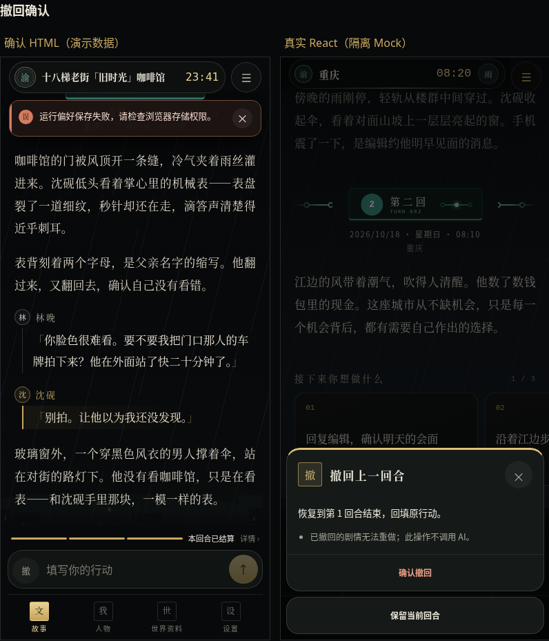
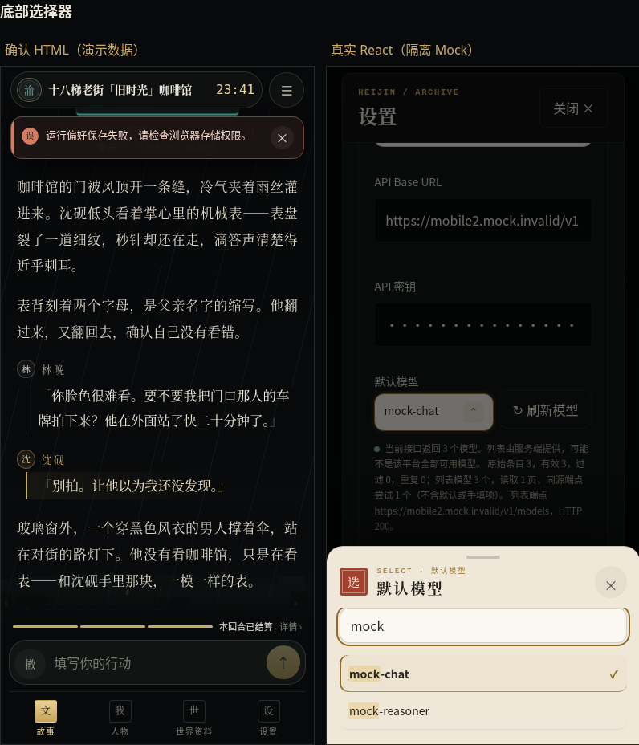
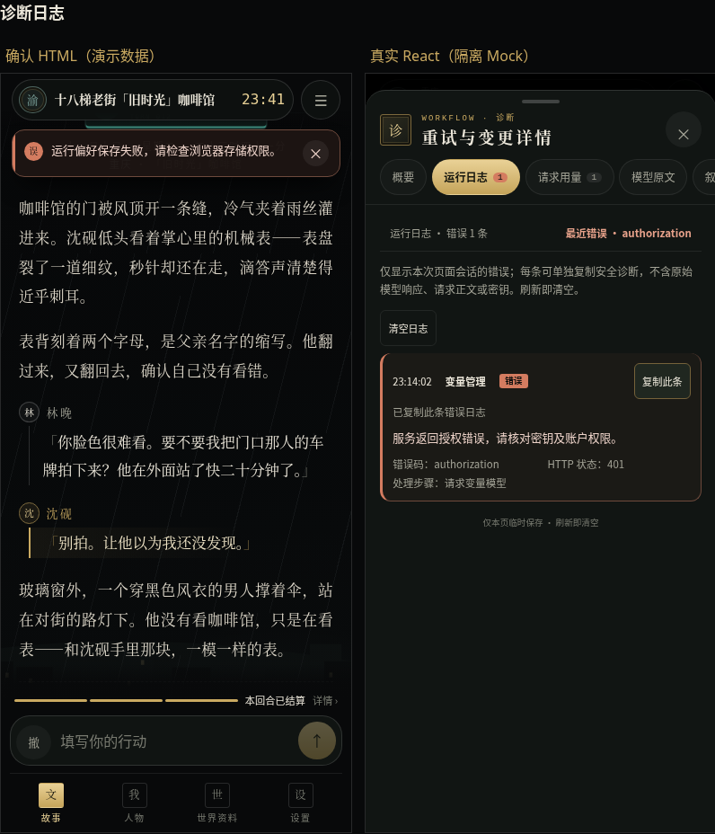
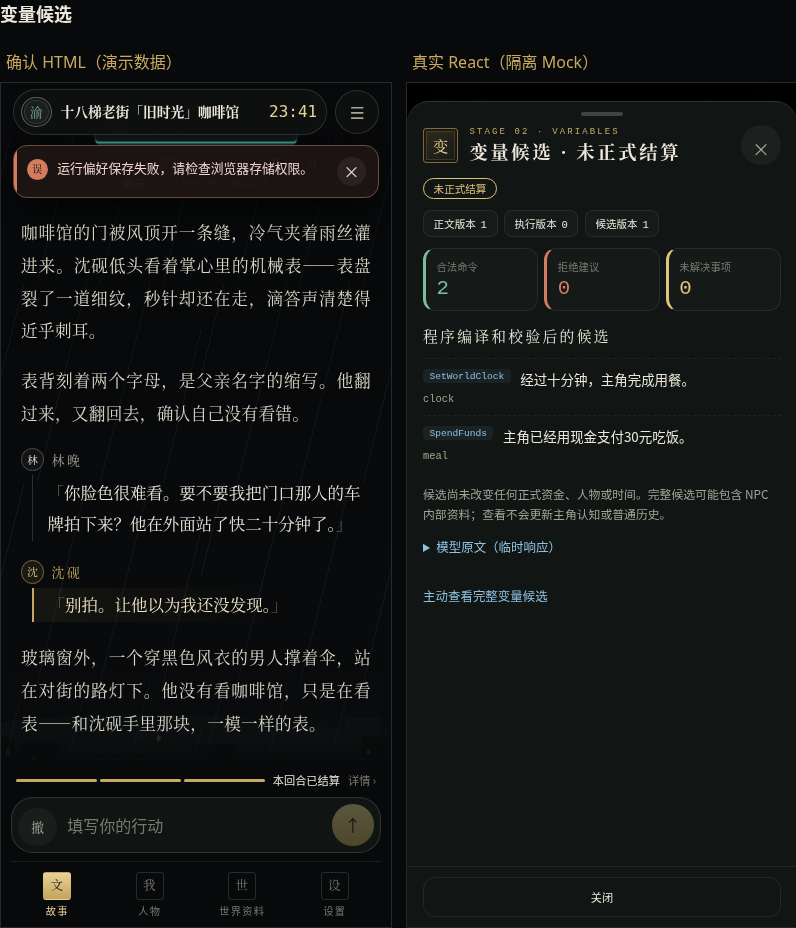

# 手机端第二批：通用交互与诊断

日期：2026-11-13（中国标准时间）。分支 `feat/mobile-redesign-batch2`。本批仅改 ≤900px 的通用交互，未开始第三批，等待九代目源码审查和玩家视觉确认。

## 基线与隔离

开工重新 fetch main，实际为 `611d88155c4c2d875a97f6f83b2f7123747ce1e7`（#122）。新建独立工作树和指定分支，未向已合并 #122 推送。

施工期间 #121 合入，已同步至 `ee1aac3d60485467e223549b83456eb0f073dbe4`，UI 修改自动应用，没有冲突。`announcement={notices.announcement}` 保留；Worker、wrangler、公告客户端、公告协议及 notices 组件与该 main 字节一致。核验见 [announcement-preservation.json](announcement-preservation.json)。未修改 KV、域名、缓存或生产部署。

最终 HEAD 随 Draft PR 与交付消息提供，也可运行 `git rev-parse HEAD`。

## 设计与实现

依据第一批仓库中的 [MOBILE_MISC_HANDOFF](../mobile-main-batch1/reference/MOBILE_MISC_HANDOFF.md)、[确认 HTML](../mobile-main-batch1/reference/heijin-mobile-misc.html)、[主界面交接](../mobile-main-batch1/reference/MOBILE_MAIN_HANDOFF.md)及[第一批报告](../mobile-main-batch1/REPORT.md)。演示数据、演示版本号、Roll 和 `#chg` 未进入产品。

| 部分 | 本批实现与行为保护 |
| --- | --- |
| 全局提示 | 游戏胶囊下方 62px／首页安全区下方 6px；深色卡、3px 状态色、圆标、完整文案和原关闭按钮；不占正文布局，不自动消失。四级通用 Feedback 保留传入 role 与原文，空消息仍为空节点 |
| 模态层上的提示 | 手机使用原生 manual popover，并挂在当前原生 Dialog 的 DOM 内，显示在抽屉之上；不增加焦点陷阱或确认流程。桌面仍输出原 alert div；创角原错误布局不变 |
| 小确认操作表 | 扩展既有 Dialog 的手机 confirm 变体；撤回、删除、记忆失败／待确认使用状态色条、方印、衬线标题、纵向原操作，取消独立底卡。已有回调、busy 条件、执行中文案与关闭守卫保留 |
| 设置未保存确认 | 继续使用原确认与编辑保留逻辑，手机采用档案纸；放弃仍需明确点击，Esc 继续编辑，不丢输入 |
| 底部选择器 | 扩展既有 Dialog 的 select 变体，最高 72% 可视区，朱砂印、字段名、16px 搜索、44px 选项、命中 mark、活动金边及已选勾号；保留箭头／Home／End／Enter、aria-activedescendant、aria-selected、禁用及回焦 |
| 嵌套选择器 | 留在最近原生 Dialog 内；父模态仅忽略子 Dialog 的 Tab／cancel 事件，父层焦点保护仍有效。选中、Esc、遮罩或 >110px 下拉只关闭当前选择层 |
| 模型与 Token | 原模型选择／刷新按钮、手动 ID、缓存、回退及请求条件不变；手机两列首行、状态色点和忙碌刷新图标，手动输入虚线框。自定义 Token 保留 1–1000000 范围、number 绑定及验证，补 numeric 与 Token 单位 |
| 诊断 | 原临时数据投影进入全屏抽屉，顶部五标签；错误新到达时打开日志标签。概要、运行日志、请求用量、模型原文、叙事规划全部可达；代码换行、12rem 内滚动；日志每条复制及清空使用原组件 |
| 用量 | 沿用现有 RequestUsage 的当前存档、非记忆请求及最近六条范围，四项原始统计用 2×2 显示；未知仍是「未提供」，不补算或计费。完整 AI 请求检查入口保留 |
| 候选 | 原 VariableCandidates／WorldCandidates 放入全屏深色抽屉；原阶段名、版本、计数、命令／拒绝／未决、安全说明完整保留，世界的任务／事件／未来计划／线索／时间轴计数仍由正式结果得出。底部仅加等价关闭入口 |
| 主动查看 | 完整候选 JSON 默认不在 DOM；原始响应另有主动展开；诊断模型原文和规划组件仅在对应标签挂载，并保留其原展开边界。原文与规范化结果分开，不写正式世界或人物认知 |
| 菜单 | 沿用 #122，不重新开发；四个按钮、PRODUCT_VERSION、首页／存档／设置／关闭、Esc 与回焦均验证 |

诊断新增三个显示指标为「运行记录」「错误」「显示的请求」，直接读取既有会话记录及原用量列表范围，不把日志条数当请求次数，也不推断缺失统计。

逐项盘点：其他创建页、OpeningPacks、须知／公告没有默认套用新 small 规则；删除渠道仍使用原 inline 确认，未改凭证删除语义。通用 Feedback 只美化其现有提示。没有新增确认、生成、补算或 Roll 入口。

## 业务与权限

未修改 GameState、IndexedDB、正式 Schema、Repository、领域规则、AI Prompt、模型路由、请求协议、原子结算、自动重试或撤回语义。

- 普通浏览前后真实 Repository 的正式状态与草稿一致。
- 模型列表在原显式打开／刷新／保存条件下读取；进入设置本身不新增列表请求。缓存与并发加载按钮复核通过。
- 无效 Token 不保存，合法 `12345` 与手动模型 ID 实际保存至原 AI 配置；配置不含凭证，不写入 GameState。
- 撤回通过原确认真正回退及回填；删除执行中 Esc、取消与再次操作受原 busy 保护，解除 Mock gate 后才真正删除。
- 记忆既有三类顺序、失败重试、只暂停本类及正式来源保护的原业务断言未改。
- 只复制原已脱敏单条日志；临时响应使用既有脱敏存储，刷新清除，读取不请求 AI。
- 截图使用隔离夹具和虚构凭证；密码字段遮蔽，未读取或输出生产密钥。

## 真实截图与设计对照

[完整并排对照](comparison.html)保留确认 HTML 与 React 的数据差异，未修改正式条件制造样式。









其他截图：

- [游戏全局提示](screenshots/react-global-error-390.png)、[首页提示](screenshots/react-home-error-390.png)、[删除确认](screenshots/react-delete-390.png)。
- [记忆失败](screenshots/react-memory-failed-390.png)、[真实 NPC 总结失败](screenshots/react-npc-memory-failure-mobile.png)、[档案纸未保存确认](screenshots/react-unsaved-390.png)。
- [模型搜索](screenshots/react-model-picker-390.png)、[手动 ID 和自定义 Token](screenshots/react-model-token-390.png)、[列表状态](screenshots/react-model-status-390.png)。
- [诊断概要](screenshots/react-diagnostic-overview-390.png)、[运行日志](screenshots/react-diagnostic-logs-390.png)、[请求用量](screenshots/react-usage-390.png)、[叙事规划](screenshots/react-planning-375.png)。
- [世界候选](screenshots/react-世界-390.png)、[375px 长响应](screenshots/react-long-response-375.png)。
- 底部选择器：[375](screenshots/react-picker-375.png)、[390](screenshots/react-picker-390.png)、[430](screenshots/react-picker-430.png)、[750](screenshots/react-picker-750.png)、[900px](screenshots/react-picker-900.png)。这些宽度也分别提供变量及世界候选截图。
- 桌面：[901px](screenshots/react-desktop-selector-901.png)、[1440px](screenshots/react-desktop-selector-1440.png)。同基线六种场景 × 两宽度共 12 组 PNG 完全一致，见 [desktop-comparison.json](desktop-comparison.json)。

设计中的演示计数与模型名替换为真实投影；设置内部页面仍为现行布局，完整档案纸设置改造留到第五批。原生叙事人称 select 等其他既有控件没有擅自换成 ThemedSelect。

## 验证成绩

Node.js **24.19.0**，Chromium **154.0.8037.57**，真实项目依赖。所有生成请求为 Mock；测试隔离拦截其他外网请求，不调用真实付费模型。

| 检查 | 成绩 | 记录 |
| --- | --- | --- |
| npm ci | 通过 | [日志](logs/npm-ci.txt) |
| npm run typecheck | 通过 | [日志](logs/typecheck.txt) |
| npm run lint | 通过 | [日志](logs/lint.txt) |
| npm run build | 通过；保留已有 >500kB chunk 提示，没有扩张拆包 | [日志](logs/build.txt) |
| 定向 Vitest 三文件 | **71 通过** | [日志](logs/unit.txt) |
| 本批 Chromium | **18 通过，0 失败／跳过／自动重试** | [日志](logs/chromium.txt)、[JSON](chromium-results.json) |
| 第一批菜单兼容补测 | **1 通过** | [日志](logs/menu-compat.txt)、[JSON](menu-compat-results.json) |
| 原生触屏横滑 | **1 通过**，标签和版本卡不误关闭 | [日志](logs/touch-recheck.txt)、[JSON](touch-recheck-results.json) |
| 选择器 Shift+Tab 复核 | **1 通过**（重复场景） | [日志](logs/focus-recheck.txt)、[JSON](focus-recheck-results.json) |
| 原记忆业务用例 × 双端 | **2 通过**，原断言未改 | [日志](logs/memory-business.txt)、[JSON](memory-business-results.json) |
| git diff --check | 通过 | 交付前核验 |

共 **22 项独立 Chromium 场景全部通过**，另重复复核 1 项选择器焦点场景，用例名称、项目和成绩见 [validation-summary.json](validation-summary.json)。未运行完整 700 项 E2E、全量 Vitest、Prompt 检查或 `npm run check` 的全量链；仅运行上述工程项和受影响用例。

PC 截图覆盖主界面、工作流、候选、ThemedSelect、未保存确认和撤回确认。图像比较在相同 Mock 状态、无 hover、字体和绘制稳定后进行；没有阈值放宽、截图遮罩或删除断言。真实手机输入法／iOS 浏览器不在本次 Chromium 验收范围。

### 发现与修复

1. 空文案的 Feedback 原路径在首版共享样式中产生空卡片，PC 同基线截图发现后恢复空节点路径，并新增回归断言。
2. 旧 `.app-shell-game .modal` 定位盖过通用 sheet，导致选择器出现在顶部；增加手机变体限定优先级。首页旧顶距、纸色确认正文和取消按钮旧 78px 上限也按真实截图修正。
3. 桌面候选图偶见几像素 hover／绘制时序差异；统一移开鼠标、等待字体与两次绘制，仍使用完整 PNG 严格相等断言。最终 12 组相等。
4. 新测试最初误把原生叙事人称 select 当作 ThemedSelect、误认为设置挂载会自动获取模型，已按真实生产代码修正测试，未新增自动请求。
5. 无效配置原本用 role=status 反馈，新测试曾误找 alert；保留生产 role，测试核对原 status、错误原文及未保存结果。单位测试的 world 夹具也补齐真实 world 候选后验证关闭时不渲染。

6. 手机 Dialog 的 Tab 环排除 `tabindex=-1` 选项，保留搜索／listbox 焦点，桌面不改；真实触屏复核后让新诊断／候选内容允许横向手势，并让诊断标签吸顶，未改既有下拉判定。

没有通过跳过、删除或削弱旧业务断言来解决失败，没有修改记忆或撤回领域系统。

## 后续范围

第三批车票首页／存档馆，第四批须知／创角／开局包，第五批深层档案、地图及完整设置布局，第六批手机本回合变化。`#chg`、公告视觉及提示词管理新设计未施工。业务入口全部保留。

## 复现

```sh
npm ci
npm run typecheck
npm run lint
npx vitest run src/tests/mobile-feedback.test.tsx src/tests/feedback.test.ts src/tests/runtime-log.test.ts
npm run build
```

桌面对照先准备同基线，单独启动 5242 服务：

```sh
git worktree add --detach ../mobile-batch2-baseline ee1aac3d60485467e223549b83456eb0f073dbe4
npm --prefix ../mobile-batch2-baseline ci
npm --prefix ../mobile-batch2-baseline run dev -- --host 127.0.0.1 --port 5242 --strictPort
```

另一个终端：

```sh
npx playwright test --config=playwright.mobile-batch2.config.ts
MOBILE_BUSINESS=1 npx playwright test --config=playwright.mobile-batch2.config.ts
```

默认配置只匹配本批 20 个 UI 场景；原业务模式只匹配 `memory-summary-v2.spec.ts` 的「NPC先失败也不阻断公共两类，失败重试仅一次；暂停只保存本类关闭」，桌面和手机各一次。配置负责 5241 本地服务；可设 `CHROMIUM_PATH`。

现有业务测试会更新它原来的截图位置；本次仅将输出复制到本批报告目录，原目录文件已恢复，没有提交无关图像变动。

完整修改清单见 [FILES.txt](FILES.txt)。仅交付 Draft PR，不合并、部署或发布，不自动开始第三批。
