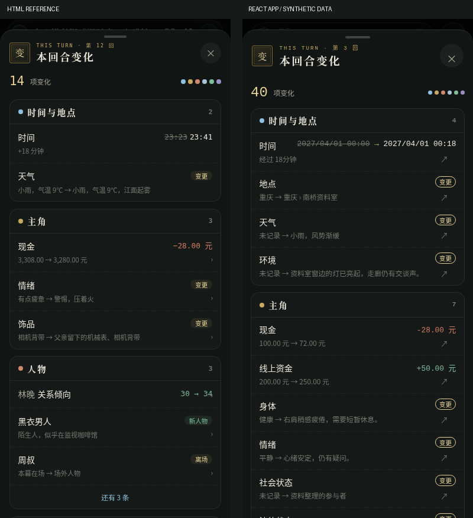
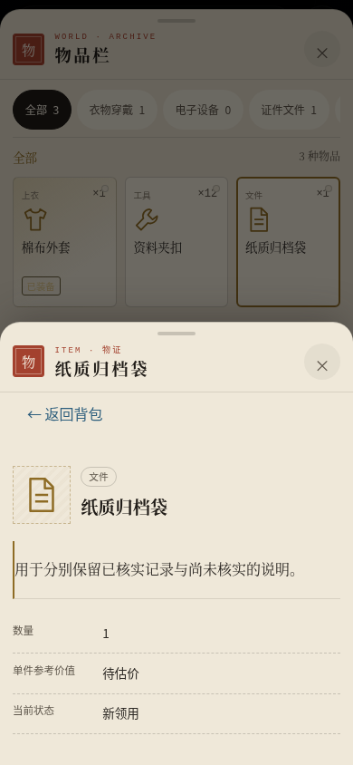

# 手机端第六批：本回合变化与世界资料角标

## 基线与施工边界

2026-11-13 开工核验 #131 已合并，main 为 `7648d3e6745b643fa03f59ac32dd805928c1bd1c`。独立工作树 `/workspace/mobile-redesign-batch6`，分支 `feat/mobile-redesign-batch6`；未继续修改第五批分支。最终开发 SHA 以本 PR HEAD 为准。

交付前 main 已由仓库另行合入 #128，成为 `0f7ed77805564e2ffa427b0b0b3446fa25ef6fdf`。该提交八个文件：CHANGELOG、README、package/lock、product、announcement 及 game-window/startup-notices 测试，和本批文件无交集。首轮交付时分支保持开工基线；#129/#132 未改动、合并或关闭。首轮截图与本地验证基于7648d3e6。**十代目返修现已同步已合并的main@0f7ed778，保留Beta文案，最新PC/交互对照也改为该main，详见末节。** 未自行合并任何PR，没有另行改写版本或公告。

已阅读手机 MISC/MAIN 交接和 HTML `#chg`、桌面 CHANGES_HANDOFF、第二及第五批报告，核对实际 GameScreen、TurnChanges、diffTurn、Repository.turnComparison/readTurnComparison、Undo、Dialog 和手机主界面样式。桌面原交接的“不在别处加标记”继续适用于 PC，本轮明确产品指令仅允许手机七资料入口的变化数，未改成未读通知。

## 设计与数据调用路径

```text
GameScreen：仅最新正式回合且原工作流条件允许
  → useTurnComparison：repository.turnComparison(state)，只读且校验完整状态/恢复点
  → 原 diffTurn(before, state) 六组（函数未修改）
  ├─ TurnChanges：原 PC 清单 / 手机 native Dialog 深色全屏 sheet
  └─ turnChangeBadges：逐条 ChangeRow.target.panel → 手机七入口数量
```

- 比较只在正式展示条件成立时读取；一份已确认结果供入口和角标共用，不为七个入口各读快照。
- 请求身份包含 state 引用、repository、展示启停状态。切换存档、撤回、新 Commit、状态更新或展示启停后立即判旧结果不可用；cleanup 拦截迟到结果，不先显示旧数字。没有跨存档或持久化计数缓存。
- 缺失、损坏或失效快照沿用不可用说明，读取中核对状态，零变化显示“无”；草稿/生成/取消后的未结算状态没有变化入口和角标。
- 六组分组、来源性质、差值、金额和已知范围都直接复用原 diffTurn。主角/经济目标不算进七个资料入口；重复涉及同一 NPC 的不同变化按实际行数计数。浏览不清角标，不新增已读状态。
- 手机 sheet 为深色，原生抓手/安全区/印章“变”/真实回合编号、汇总及分类点、单列分组；每组默认8条，原“还有N条”手动展开。没有省略长文本或把未知金额改成0。
- 手机行最后调整为两行密度，目的地文字仍在可访问名称中，视觉为右下箭头。与 HTML 的数据内容不同，原型14项与合成世界40项不要求逐字或数据像素一致。
- 跳转关闭变化 sheet，同步调用原 openChange，无固定setTimeout。目标资料关闭时回到仍存在的变化入口。触摸遮罩关闭后局部 rAF 恢复入口焦点，且有其他原生弹窗时不抢焦点；未修改通用 Dialog。
- 接通物品 initialId、历史/记忆原阅读状态，使九类目标能到达正式记录。无对象ID的丢失物品/任务等仍进入原列表；不造记录。保留第五批 MapPanel 目标优先级，地图代码未改。
- #120 工作流仍为原非模态，输入、发送、取消和恢复回调均未改。手机模态变化抽屉不重构工作流。

## 修改清单

[完整实现文件列表](validation/implementation-files.txt)，首轮11个源码/测试/配置文件，返修后增加InventoryPanel.tsx，共12个。另新增本报告、验证输出及截图。

| 文件 | 目的 |
| --- | --- |
| `src/ui/game/GameScreen.tsx` | 双端正式入口、共享只读结果、手机角标及目标阅读状态/安全回焦 |
| `src/ui/game/TurnChanges.tsx` | 保留 PC 清单；手机深色 native sheet，复用原行/组组件 |
| `src/ui/game/useTurnComparison.ts` | 提取原比较读取，状态身份和迟到结果隔离 |
| `src/ui/game/turnChangeBadges.ts` | 仅按正式目标逐行计数的纯投影 |
| `src/ui/game/turn-changes.css` | 仅新增 max-width900 样式，PC原规则保留 |
| `src/ui/panels/Panels.tsx` | 转发明确外部物品 initialId，不新增业务 |
| `e2e/helpers/turnChanges.ts` | 提取原合法合成状态、恢复点、原始导出及只读守卫 |
| `e2e/turn-changes.spec.ts` | 六项旧测试支持正式手机行为；不再断言手机无入口，不跳过手机导航/压力测试；保留原业务断言 |
| `e2e/mobile-turn-changes.spec.ts` | 五尺寸、计数、延迟/切档、Undo、只读、手势及真实PC主干对照 |
| `src/tests/mobile-turn-changes.test.tsx` | target计数、零变化/不可用、禁用语义 |
| `playwright.mobile-batch6.config.ts` | 单worker、零retry，仅定向文件/项目；不是700项套件 |

相对开工基线，自查 domain、services（含Repository/备份/Undo）、executors、workflows、prompts、原diffTurn、App/useGameViewport、MobileWorkflowDrawer/WorkflowPanel、首页/创角/公告、Cloudflare、发布工作流、版本和锁文件没有修改。没有新增 Schema、IndexedDB store、模型请求、费用机制、历史或人物真值。

## 工程及定向验证

Node **v24.19.0**，正式锁文件执行 `npm ci`（143 packages），Chromium `/usr/bin/chromium`，真实 React + IndexedDB；没有浏览器 shim。所有模型响应均 Mock。

| 独立批次 | 通过 / 失败 / 跳过 | 说明 |
| --- | --- | --- |
| 定向Vitest初轮 | 43 / 0 / 0 | 原diffTurn、真实Repository比较和新手机投影，3文件 |
| 最终定向Vitest | 43 / 0 / 0 | 3文件再次验证 |
| 最终Prompt检查 | 93 / 0 / 0 | 3文件，无Prompt修改 |
| 既有变化Chromium | 12 / 0 / 0 | 六项用例桌面+手机，含真实Commit/Undo/重结算、九类跳转、金额/来源/长列表、生成/取消 |
| 新增Chromium初轮 | 8 / 3 / 0 | 五尺寸/降级等通过，三处失败详见下节 |
| 定向修复复测r2 | 4 / 1 / 0 | 延迟切档、焦点、稀疏角标、实际Undo通过；901整图仍有微小像素差异 |
| PC字体条件r3 | 0 / 2 / 0 | DPR1字体参数未消除整图差异，未放宽断言 |
| PC软件渲染r4 | 0 / 2 / 0 | 软件渲染也未消除差异，保留记录 |
| PC统一整数DPR2 r5 | 2 / 0 / 0 | 901/1440、收起/展开四对完整PNG严格相等 |
| 六批兼容冒烟 | 6 / 0 / 0 | 首页/创角/须知公告/设置/地图/#120，均为既有定向用例 |
| 新增最终整批 | 13 / 0 / 0 | 单次完整本批新验收，含PC、切档与实际Undo |
| 最后手机行密度修正后定向 | 7 / 0 / 0 | 五尺寸、九类跳转、长列表；仅手机CSS，未将此前批次相加冒充一次全绿 |
| 最后PC保护复核 | 2 / 0 / 0 | 901/1440完整PNG继续严格一致 |
| 物品显式目标与正常入口最终复核 | 1 / 0 / 0 | 九类目标、正常物品入口回网格、无误开的子抽屉、丢失物品列表、正式记录只读 |

工程：typecheck、lint、build、prompts:check、diff检查通过。最后自查保留PC在同回合状态更新后的原展开行为，并区分手机显式物品目标与普通物品入口：普通入口不会因上次目标而自动重开详情。最终typecheck、lint、build（含typecheck）通过，相关导航与PC分别复测；保留原有 >500kB chunk提醒。一次早期typecheck指出旧测试移除desktop分支后残留未用`info`参数，删除无用参数后复测通过，没有改断言。

每项状态、时长及各批原始输出见 [validation](validation/) 与 [chromium-batches.json](validation/chromium-batches.json)。日志仅清理行末空格/末尾空行，未更改结果。完整临时trace仍在任务 `/tmp/mobile-batch6-*`，不将临时目录声称为长期备份。

### 失败与修复依据

1. 延迟测试固定期待一次effect，实际开发StrictMode会执行两次生命周期。改为捕获该代的真实待处理数量并释放同代结果，仍检查切换存档后旧结果不得显示，新存档必须等待自己的结果。独立事务计数测试证实反复打开入口/世界资料不新增比较事务；没有新增模型请求。
2. 原生遮罩触摸关闭后，浏览器默认焦点处理会晚于卸载回焦。只在本组件close后rAF检查入口存活且无其他modal，再恢复焦点；实际触摸遮罩、短视口、按钮关闭、Esc及下拉关闭复测通过。不使用setTimeout同步导航，不改Dialog框架。
3. DPR1 PC整图出现少量毛玻璃/文字边缘像素差异（一次901为18像素，后一次22像素，位置不固定；主体布局与文案未变）。暖截图、字体参数和软件渲染未解决，失败全部保留。最终固定双方相同的901/1440 **CSS视口、整数DPR2、字体渲染参数、字体加载/绘制状态**，保留整张PNG严格相等，不使用阈值、裁切、mask或去除背景。最终13项中再次通过PC两例。最后手机两行密度CSS全部限定max900，不影响这些PC规则。

### 业务安全断言

- 比较和浏览前后 `exportRaw` 全部正式存档/草稿/撤回快照/控制/回执记录保持一致，浏览模型请求为0。
- 生成/取消及#120冒烟含受控Mock POST并按原请求次数断言，不将这些生成测试说成“所有测试POST均为0”；真实付费模型调用为0。
- 真实Repository提交、撤回消费快照、刷新、再Commit均验证；撤回失去可靠前态后角标消失，不恢复废弃时间线数字。
- NPC人物私有记录、转述、推测、世界客观记录保持原性质，不授予主角新知；内部ID、identityKey、私密身体和休眠档案不新增到清单。
- 长列表初始8/展开48、未知金额、极大金额和完整文本末尾均有真实浏览器断言。没有修改差异、可见性或金额算法。

## 真实界面证据

[全部截图](screenshots/)包含375×667、390×844、430×932、392×420、900×800的入口/抽屉/七入口角标，短视口、九类跳转、长列表、生成中以及六批兼容场景。



左为正式HTML `heijin-mobile-misc.html#chg`，右为真实React合法合成世界。卡片色、方印、标题、汇总、分组色点、单列/两行与更多条目对照；正式内容和条数不同，未把演示人物/金额接入产品。

PC对应原始 `main-pc-*` / `react-pc-*` 图片及 [901结果](validation/pc-901.json)、[1440结果](validation/pc-1440.json) 使用未修改的开工主干7648d3e6；均同时展示左右原侧栏入口、正文/行动台和收起/展开变化区域，无手机角标。

## 收官状态与剩余验收

| 状态 | 本轮实际情况 |
| --- | --- |
| 六批手机UI开发 | 本批代码完成，Draft等待十代目源码复审与玩家视觉确认，不代表已验收合并 |
| 自动化回归 | 本轮定向批次按上表通过，早期失败保留；没有执行约700项全量E2E或全量Vitest |
| 真实手机验收 | **未完成**，自动化不等同真机 |
| Beta部署 | **未执行**，不操作Cloudflare生产配置 |
| 1.0正式发布 | **未执行**，不创建Release/不改版本文字 |

实机待验：iOS Safari/Android Chrome真实IME及visualViewport、横竖屏/系统安全区、连续触摸/滚动与拖动关闭、VoiceOver/TalkBack朗读数量/目的地、字体放大与低端机长列表性能。浏览器短视口/触摸模拟不能替代这些项目。参考图与PC对照都为实际浏览器截图，未用静态HTML冒充正式React。

未发现本轮数据或流程阻断项；最新main的#128版本公告组合没有冒充本地已测。只提交独立Draft PR，不合并、不主动部署、不发布，不开始其他开发任务。


## 十代目定向返修：自动直达物品的原生模态层级（2026-11-13）

审查：review `5889822261`，返修前 HEAD `88d2a5e1cdb5a7d47e5824ab8cd44e9cfe4f39db`，远端无后续提交、工作区干净。修复提交 `1e1d7e1`，随后以 `ddfe394` 无冲突同步当前 main `0f7ed77805564e2ffa427b0b0b3446fa25ef6fdf`；最终完整SHA见本PR HEAD。只是将已合并的main同步到开发分支，没有合并PR或推送main。

### 真实复现与根因

手机InventoryPanel原先在初次render就以initialId选中物品。同一个React提交中新建内外两层native Dialog，内层effect先showModal，外层随后showModal并盖在内层上。原九目标测试只检查外层文本和一次Esc，未证明内层真正可点击；因此首轮导航通过不能消除本风险。

新增专门Chromium先在原审查HEAD实际点击“变化→纸质归档袋→←返回背包”，**0通过 / 1失败 / 0跳过**。Playwright报告外层modal-body拦截指针，未使用force click。命中证据如下：

| 观察 | 修复前 | 修复后 |
| --- | --- | --- |
| 返回按钮中心elementFromPoint落入内层按钮 | false | true |
| 活动元素 | DIALOG（外层） | H3（内层详情标题） |
| 活动元素位于内层 | false | true |
| 原生dialog:modal数量 | 2 | 2 |

modal数量仅记录存在数量，不把DOM查询顺序误称为top-layer顺序。真实命中、真实click、焦点和Esc行为共同证明层级。前值见 [before-hit-test.json](validation/nested-item-review/before-hit-test.json)，后值见 [nested-item-hit-test.json](validation/nested-item-hit-test.json)。

### 最小实现

**生产增量只有InventoryPanel.tsx**：PC仍在初始化时选中initialId；手机先挂载背包网格，在effect中设置目标选中，产生下一次React提交。父层Dialog的本次passive effects先完成，内层才在下一提交showModal。没有setTimeout、固定等待、额外rAF或调用showModal重排；没有修改通用Dialog生命周期、CSS、GameScreen、工作流、领域或存储。

正常点击网格的详情行为不变；无initialId的普通入口不自动打开详情，失去/不存在的物品使用列表。inner关闭后回原物品卡，网格DOM不卸载；outer关闭回变化入口。

### 测试强化与本轮结果

- 新专门测试真实点击内层“返回背包”，外层分类仍可点击；再次进入时标题已聚焦，第一次Esc只关内层，网格DOM为同一节点且回焦原卡；第二次Esc才关外层并回焦变化入口。
- 普通世界资料→物品栏没有上次详情；失去物品进入可用列表。全流程raw export深比较不变，浏览模型请求为0。
- 原九目标测试不再用一次Esc把内外层一起卸载作为成功；增加内层标题焦点、分层Esc和外层保留断言。未删除或弱化旧业务/隐私/请求/存储断言。

| 本轮独立批次 | 通过 / 失败 / 跳过 |
| --- | --- |
| 修复前专门Chromium | 0 / 1 / 0 |
| 修复后手机专门场景+九目标（同步main前） | 2 / 0 / 0 |
| 定向Vitest（物品协议、差异、手机投影，3文件） | 47 / 0 / 0 |
| 同步main后同三文件Vitest | 47 / 0 / 0 |
| 整合main后Chromium：专门场景、双端九目标、#120、PC901/1440 | 6 / 0 / 0 |

当前Node24环境已使用正式锁文件依赖；本次main合入的package/lock差异仅为包版本元数据，依赖未变，未重复安装。同步后typecheck、lint、build和diff检查通过，构建仅有原大chunk提醒。未修改Prompt，未重复此前93项Prompt或完整六批/700项浏览器套件。原始批次输出与每项结果见 [本轮证据](validation/nested-item-review/)。日志只清理行末空白，不改结果。

```sh
npx vitest run src/tests/inventory-v2.test.tsx src/tests/mobile-turn-changes.test.tsx src/tests/turn-changes.test.ts
CHROMIUM_PATH=/usr/bin/chromium npx playwright test e2e/mobile-turn-changes.spec.ts e2e/turn-changes.spec.ts e2e/pr120-integration.spec.ts --config=playwright.mobile-batch6.config.ts --grep '变化直达具体物品|变化行使用|抽屉打开时真实输入发送|PC 901|PC 1440'
npm run typecheck
npm run lint
npm run build
git diff --check
```

### main/Beta及PC保护

已同步main@0f7ed778；package/lock为1.0.0-beta，PRODUCT_VERSION为V1.0 Beta，内置公告为builtin-1.0-beta。上游#128八个文件与该main逐字节无差异，未覆盖文案。#129/#132没有被合并、关闭或部署。

PC901/1440在双方一致DPR2/字体条件下，收起/展开**四对完整PNG严格相等**；这次基线是0f7ed778，已不是首轮7648d3e6。[本轮901结果](validation/nested-item-review/pc-901.json)、[本轮1440结果](validation/nested-item-review/pc-1440.json)及[整合截图](review-screenshots/)。首轮screenshots与原批次记录保留，不以新版覆盖旧基线证据。



没有真实付费模型调用或玩家存档操作；#120受控Mock生成/取消/恢复/单次结算继续通过。没有新增UI功能或更换六批设计。真机IME/连续触摸/读屏等未验证边界保持原说明。PR仍Draft，等待十代目复审，不合并、不主动部署正式站、不发布。仓库已有Cloudflare集成可能因推送自动生成预览，与主动生产部署及发布不是同一回事。
