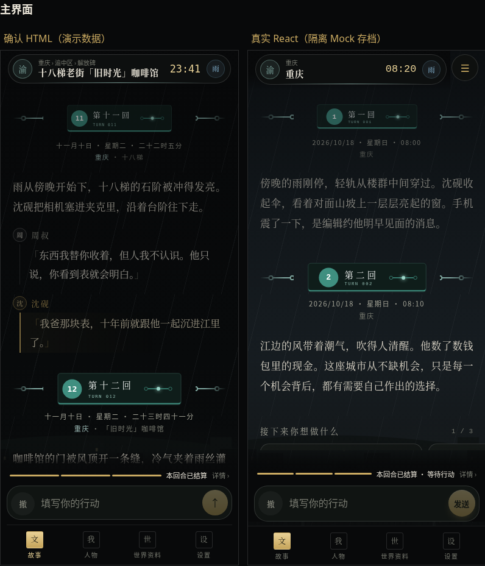
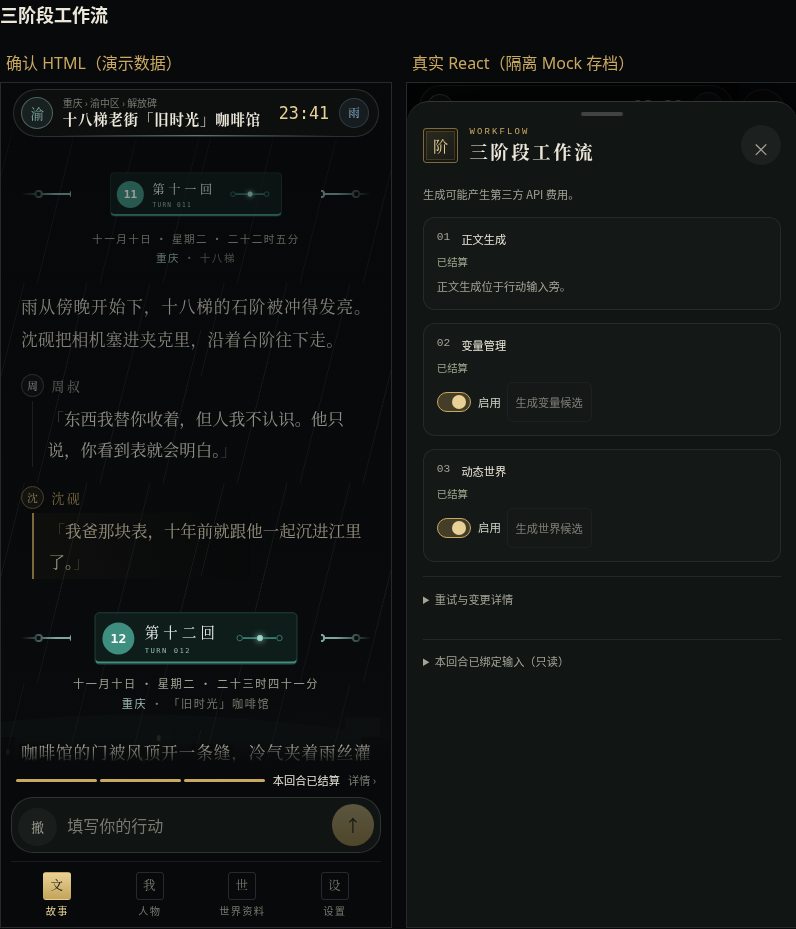

# 手机端第一批：游戏主界面骨架

日期：2026-11-13（中国标准时间）。分支：`feat/mobile-redesign`。本批仅修改 ≤900px 的游戏页面与其抽屉；等待九代目及玩家视觉复审，不自动开始第二批。

## 基线和独立性

开工重新 fetch 的 main 为 `d6ef539b8217b9dcf1e48e6161b26dbb7b42f53c`（#117）。施工期间 main 合入 #119，随后仅从 main 快进同步至 `d73b95db51a99142b58ba33e406836b0dd9f957d`。两者生产源码一致；新增的质量组文件保持原样，没有访问或修改其开发分支，没有参与其 Bug 清理。与本轮改动无冲突。

使用独立工作树；原有工作树未修改。最终 SHA 见 Draft PR 及交付消息，也可运行 `git rev-parse HEAD`。公告 PR #121、Worker、KV、生产路由与部署均未接触。

## 设计依据和本批交付

读取上传包的 README、六份交接文档与对应 HTML，按批次界限使用主界面稿和 misc 中的游戏菜单规范。原文件摘要见 [design-sources.json](design-sources.json)。本批使用的原稿保存在 [reference](reference/README.md)，演示控制、演示人物与演示逻辑仅留在参考文件。

| 确认设计 | 真实 React 实现 |
| --- | --- |
| 城市胶囊和右侧圆形菜单钮 | 固定开局城市印章，实际地点路径、正式时钟、天气；往下滚动超过 60px 收窄，向上恢复；完整信息在状态抽屉中可读 |
| 城市氛围 | 直接复用现有 `CityAtmosphere` 和 `skyline.ts`；五档光照与当前天气，CSS 雨雪雾效果，不新增城市数据或图片请求 |
| 沉浸正文 | 衬线正文，头像和姓名一行、台词独立缩进；保留完整原文和可访问回合标题；四城铭牌缩放、历史 scene 两行副标题 |
| 行动建议 | 76% 宽横滑卡片、页码和圆点；点击只填入并聚焦输入框，不自动发送；支持时轻震 8ms，reduced-motion 时不震动 |
| 固定行动台 | 三段 3px 状态条、原状态文字、详情入口；16px 输入自动增高至 120px；原发送、取消、生成和撤回条件不变 |
| 次要操作 | 单操作为「撤」圆钮，多操作为「⋯」菜单；控制器始终挂载，折叠不取消运行、不丢撤回状态 |
| 四项导航 | 故事／人物／世界资料／设置，印章和当前态；人物先打开状态抽屉，再进入完整原人物档案或经济面板 |
| 状态抽屉 | 当前时间日期星期时段、地点、天气环境；真实身份、精确资金、完整身体情绪、七项装备和两个原入口 |
| 世界资料 | 七项印章网格；关闭目录后在同一次 React 更新交接至原资料内容，避免定时器造成快速操作竞态 |
| 游戏菜单 | 三个原操作、真实 `PRODUCT_VERSION`、独立关闭卡片；菜单与设置原导航行为保留 |
| 原生 Dialog 手机变体 | 原生模态、ARIA、Tab 环、Esc、遮罩、回焦和滚动锁复用；容器初始焦点；下拉超过 110px 关闭，取消及短拉回弹 |

状态长文本不截断，金额不省略或缩写；空值沿用正式降级。开局未确认显示 `--:--` 和「开局时间待确认」，不将设备时间或占位时钟伪装成游戏日期、时段。空天气显示「—」，不编造晴天。

UI 读取真实 GameState，未改 GameState／IndexedDB／存档 Schema、协议、提示词、模型路由、阶段执行、结算或撤回规则。NPC 星标等现有操作保持原实现。浏览、搜索入口、选建议和阅读前后通过真实 Repository 对比；测试中的显式结算、发送和撤回仍按原机制写入。

## 截图与视觉核对

[完整 HTML／React 对照页](comparison.html)包含主界面、状态、世界资料、工作流及菜单。左侧为静态确认稿，右侧是实际 React；两边人物、时钟、地点和工作流状态不同，未为截图改写正式业务条件。





- 主界面：[375×667](screenshots/react-main-375.png)、[390×844](screenshots/react-main-390.png)、[430×932](screenshots/react-main-430.png)、[750×800](screenshots/react-main-750.png)、[900×800](screenshots/react-main-900.png)。600–900px 直接使用手机版，不复制设计稿的手机机框或演示按钮。
- 状态与资料：[状态](screenshots/react-status-390.png)、[完整长状态](screenshots/react-status-long-390.png)、[世界入口](screenshots/react-world-390.png)、[菜单](screenshots/react-menu-390.png)。
- 工作流：[开局待定](screenshots/react-opening-390.png)、[候选完成](screenshots/react-ready-390.png)、[错误诊断](screenshots/react-error-390.png)、[运行中](screenshots/react-busy-390.png)、[Mock 失败恢复](screenshots/react-failure-390.png)。
- 阅读与输入：[长正文](screenshots/react-long-reader-390.png)、[对白和建议](screenshots/react-dialogue-390.png)、[可视区缩小](screenshots/react-keyboard-390.png)。
- 桌面：[901px](screenshots/react-desktop-main-901.png)、[1440px](screenshots/react-desktop-main-1440.png)。两种宽度的主界面、工作流和 NPC 共六组，与未修改 main 使用相同正式夹具进行完整 PNG 字节和像素比对，全部相同。详见 [desktop-pixel-comparison.json](desktop-pixel-comparison.json)。

仅验收 Chromium；软键盘通过现有 `visualViewport.resize` 更新路径模拟可视高度，不宣称已经用真机验证 iOS／Android 输入法。保留现有 pinch-zoom 分支与安全区逻辑。

## 验证结果

环境：Node.js **24.19.0**、Chromium **154.0.8037.57**、真实 `npm ci` 依赖。所有生成请求使用隔离 Mock 地址，其他外网请求拦截，不调用真实付费模型。

| 检查 | 结果 | 原始记录 |
| --- | --- | --- |
| `npm ci` | 通过，143 packages | [日志](logs/npm-ci.txt) |
| `npm run lint` | 通过 | [日志](logs/lint.txt) |
| `npm run typecheck` | 通过 | [日志](logs/typecheck.txt) |
| `npm run build` | 通过；Vite 仍有 >500kB chunk 提示，未扩张为拆包重构 | [日志](logs/build.txt) |
| 两份定向 Vitest | **19 通过**，含 6 个手机投影用例与原正文解析用例 | [日志](logs/unit.txt) |
| 手机新界面与桌面隔离 Chromium | **19 通过，0 失败，0 跳过，0 自动重试** | [日志](logs/chromium.txt)、[JSON](chromium-results.json) |
| 原业务 Chromium 双端冒烟 | **4 通过**：两个原用例 × 手机／桌面，断言未修改 | [日志](logs/workflow-smoke.txt)、[JSON](workflow-smoke-results.json) |
| 菜单打开态描金最终复核 | **1 通过**，重复 390px 场景，非额外独立业务场景 | [日志](logs/menu-polish.txt)、[JSON](menu-polish-results.json) |
| `git diff --check` | 通过 | 交付前核验 |

独立 Chromium 场景共 **23 项全部通过**；最后描金复核重复执行 1 项。用例名称及结果见 [validation-summary.json](validation-summary.json)。没有运行全量 Vitest、Prompt 检查、完整 E2E 或 700 项浏览器回归。

覆盖：五种手机尺寸、901／1440px 桌面；未开局、草稿、候选完成、正式结算、运行、失败恢复；变量和世界原候选弹窗、嵌套 Esc；Tab 环、遮罩、回焦、正常动效及 reduced-motion；真实触屏滚动和下拉；完整长状态、极大金额、长正文、建议和多行输入；正式结算不请求模型、下一轮发送、取消、撤回确认与回填；原设置分类和菜单回焦。

原业务冒烟使用 `action-workflow.spec.ts` 中以下两个既有用例，桌面和手机各执行一次：

1. 一次创角确认自动执行开局三阶段，StrictMode和重复点击不重复请求。
2. 发送行动只结算一次并自动串联下一轮，刷新及再次读档不补发。

### 本轮发现及修复记录

- 新抽屉嵌套候选 Dialog 的 React `cancel` 事件会传至父抽屉，导致 Esc 同时关闭两层。仅在手机 sheet 检查事件归属，父抽屉不消费子 Dialog 的 cancel／Tab；候选完整数据、关闭回焦和正式草稿复核通过。
- 原手机版样式曾隐藏建议卡末尾提示、给当前导航加旧顶边；补全手机专用覆盖。工作流卡宽度与单行输入初始高度也按实际截图校正。
- 下拉结束回弹原先会重新触发入场动画；首次拖动后保留已交互标记，正常动效与 reduced-motion 均验证。
- 早期执行环境重启导致本地 5231 服务中断，一次 13 项运行在进入页面时失败；由定向配置负责启动本地服务后解决，不归因为生产故障。
- 新增测试夹具曾误写可选 literal(true) 开局字段为 false、给无恢复点的开局回合期待撤回数量、把回填后的正常等待行动误认为应有生成按钮；改为正式创角构建、现有回合语义与真实字段。没有改 Schema、领域行为或既有业务断言。
- 触屏压力测试初次在惯性滚动未结束时立即反向拉动，正式逻辑正确地不关闭；改为重新打开从顶部开始，分别验证内容滚动与顶部下拉。输入法模拟使用既有 shell 的 visualViewport 路径。

## 仍属于后续批次

第二批的全局提示、确认操作表、通用选择器以及诊断／候选内部排版；第三批车票首页；第四批须知、创角与开局包；第五批 NPC 等内部资料页、设置和地图；第六批手机本回合变化、资料角标及收尾。上述功能保留现行实现，本批仅将已有资料内容接入通用抽屉外壳。撤回确认和候选继续使用原弹窗，不提前重做它们。

设计包的「重新 Roll」演示文字不进入产品；手机本回合变化不在第一批提前实现。人物和经济完整资料仍可从状态抽屉进入。没有删减正式功能或访问字段。

## 复现

本批配置只匹配 `mobile-main-batch1.spec.ts`；业务模式只匹配上述两个原用例。默认不触发全量测试。

```sh
npm ci
npm run lint
npm run typecheck
npm run build
npx vitest run src/tests/mobile-main.test.tsx src/tests/story-reading.test.ts
```

桌面对照需要另外准备未修改的同一基线并启动本地服务：

```sh
git worktree add --detach ../mobile-main-baseline d73b95db51a99142b58ba33e406836b0dd9f957d
npm --prefix ../mobile-main-baseline ci
npm --prefix ../mobile-main-baseline run dev -- --host 127.0.0.1 --port 5232 --strictPort
```

在第二个终端运行：

```sh
npx playwright test --config=playwright.mobile-batch1.config.ts
MOBILE_WORKFLOW_SMOKE=1 npx playwright test --config=playwright.mobile-batch1.config.ts
```

默认使用 `/usr/bin/chromium`，其他安装位置可设 `CHROMIUM_PATH`。本配置负责 5231 开发服务；应确保该端口没有其他工作树的服务。设计原稿及对照页可用本地 HTTP 服务查看。

修改文件完整清单见 [FILES.txt](FILES.txt)。最终仅创建 Draft PR，未合并、部署、发布或打标签。
