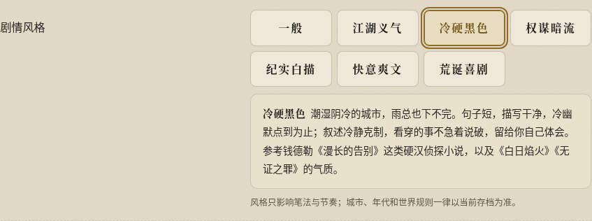
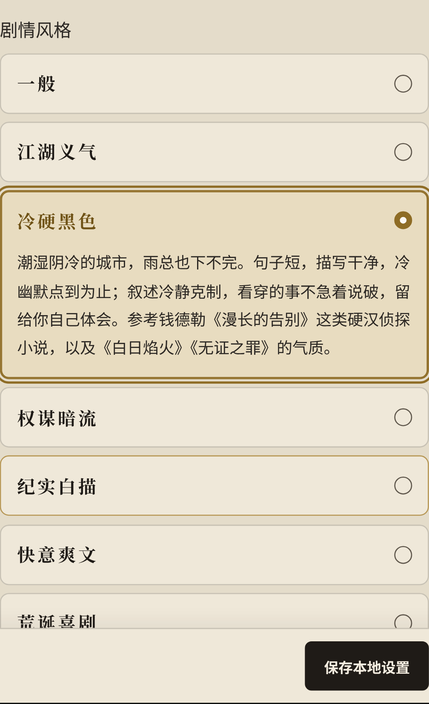

# PR #188 Story 快照返修与正式验收

验收日期：2026-11-18（北京时间）。结论：通过，未发现剩余 P0/P1/P2 阻断；提交十五代目复审。本轮不加公告、不合并、不部署。

## 基线与整合

- 开始时 PR HEAD：`126f41306e5b36a094a5ad00f074bc2c3e3b6d2b`，原远端分支 `feat/anti-template-prose`。
- 实际最新 main：`147a166e2678022a04ed30f7c011e1fd6c42a822`，结束前重新 fetch 后未变。
- 将 main 正常 merge 入原 PR 历史，整合提交：`23655a1b73114bd3fbf24a9d21af3ea82815b669`，无冲突、无 force push。
- #187 七风格及 Memory 误唤醒修复完整继承。`composer.ts`、`memoryMaintenance.ts`、`useMemoryMaintenance.ts` 与 main 无差异。
- 最终交付 HEAD 记录在原 PR 的本轮验收评论；本报告与快照修复一同提交。验收内容为上述整合提交加本报告所列 fixture 差异，fixture 文件 SHA-256：`90ea727ae9f8b6c642725dda2e7c61f599137fbd9c63bdc66c8ab78f32616f55`。
- 开始时 GitHub 实际为 Open、非 Draft、未合并；本轮不改变 PR 类型或合并状态。

## 先复现，再逐项核对

整合后先执行原 `talent-context.test.ts`：27 通过、2 失败（opening/regular 消息哈希），退出码 1。干净 main 同 Node、锁文件依赖下：29 通过，退出码 0。原失败日志保留，未删除或改写断言。

正式 Vitest 临时取证测试直接调用仓库 `talentPromptInput` 与 `composePrompt`；与正式快照用例一致，删除输入中可选的 `maxNarrativeChars` 后生成两份 legacy 请求。临时测试仅写合成测试数据至隔离目录，运行后移出工作树，没有修改正式测试。原始捕获脚本与全部请求在证据包中。

先确认 main 的 messages/modules/context 三类哈希均逐项匹配原 fixture，再比较整合分支：

- opening、regular 均为 23 个模块、25 条消息；模块 ID、版本、数量、角色、顺序不变。
- 仅第 15、20 条（从 0 起）system 消息发生变化：`writing.natural_prose` 与 `planning.opening` / `planning.regular`。
- 模块元数据仅变化 `contentSha256`、`characters`、`estimatedTokens`。自然文风 877→1677 字符；opening 规划 3582→3695；regular 规划 5710→5856。
- 两份完整 Context、最终格式提醒、正文输出协议、篇幅模块及其余消息逐字相同。两个 context 哈希保持原值。
- 逐文本差异已核查：自然文风增加分类反模板规则、跨回合重复约束、风格关系及仅作用正文的边界；规划只增加对应场景的文风预检条目。没有修改事实输入或输出协议。

额外在 main 和整合分支分别用正式组包器生成 126 组固定输入：七风格 × 自然文风开关 × Story/Variables/World 开局与普通回合，以及三种 Memory 任务。结果：28 组 Story 仅有上述预期模块差异；98 组非 Story 的完整 messages、modules、context 和其他返回字段完全一致。每组 Story 仅有一个风格模块，排除风格文本及标识后完整消息一致；自然文风关闭时不注入该模块，规划预检按 #188 原方案保留。

这些是固定输入的组包与校验验证，不能据此保证真实模型的文学质量或摘要绝不受文风影响。

## 四个哈希更新

| 模式 / 字段 | 原哈希 | 新哈希 |
| --- | --- | --- |
| opening / messages | `6ff67411227812c1866d17508a39b03a658bd4de8ea86dff244103b56907ce6c` | `ba52ccc3ee0c55ae92a216f0ef4fc4d49997838b071dc52daa079850882f614a` |
| opening / modules | `396a4b87727d77005ccbaa6d29be5047adb40ab888be5930fcb0a78d524ae40e` | `011acefccf1d20080087dde255b4df9b5c05b4a49edb87cb9b7196f5d462ccdb` |
| regular / messages | `3f85c93e51dcfaa365da5661aaca0114e59ee6d2c53b4c5ec0aa3c3cbad5fd30` | `463eb7236a02f6b96622d48f16d433c715bc63480e8f01b8a4d01c93304eddf5` |
| regular / modules | `37052bf73b4078f46002959b886d31af7f1c052a1ba40bf0fa82c644cf37c2a6` | `6ef42e47bbee05c38c39a19df6a7a811254fefcc55d103be351cfc00b1931fd5` |

只更新 `talent-story-length-baseline.json` 的这四个值及 `base`、`reason`。没有刷新 Context 或 Variables / World / Memory 的任何旧基线；没有动态生成测试期望、删除哈希断言或放宽业务校验。

## 正式工程与浏览器结果

环境：Node **v24.19.0**、npm **11.9.0**、Vitest **5.0.5**、Playwright **1.64.1**、Chromium **154.0.8037.57**（`/usr/bin/chromium`），真实项目锁文件依赖。

| 批次 / 命令 | 结果 | 退出码 | 原始日志 |
| --- | --- | --- | --- |
| `npm_config_cache=/workspace/.npm npm ci` | 安装 143 包成功 | 0 | `npm-ci.log` |
| 修复前 `npx vitest run src/tests/talent-context.test.ts` | 27 通过 / 2 失败 / 0 跳过 | 1 | `red.log` |
| 干净 main 同一快照文件 | 29 通过 / 0 失败 / 0 跳过 | 0 | `main-talent.log` |
| 修复后六文件定向 Vitest | 104 通过 / 0 失败 / 0 跳过 | 0 | `green-focused.log` |
| `VITEST_MAX_WORKERS=2 npm run check` | 184 文件、4383 项通过；0 失败 / 0 跳过；ESLint、文件名、catalog、TypeScript、Build 全通过 | 0 | `check.log` |
| `npm run prompts:check` | 3 文件、93 项通过；0 失败 / 0 跳过；Manifest、来源锁检查通过 | 0 | `prompts.log` |
| 原生 Playwright，限定两文件与三个用例名 | PC 3、手机 3，共 6 通过；0 失败 / 0 跳过 | 0 | `browser.log` |
| `git diff --check`、暂存区差异检查 | 无空白错误 | 0 | `diff-check.log` |

定向六文件：`talent-context`（29 项全绿）、`anti-template-prose`（5 项全绿）、`story-styles-isolation`、`story-styles`、`story-continuation`、`prompt-cache-ordering`。

104 定向、93 Prompt 与完整 4383 的测试集合重叠，不能累加成独立通过数。取证捕获 main/PR 各 1 个 Vitest 用例分别通过，不计入正式 4383。

Chromium 原配置仅改隔离服务器端口、输出目录及 workers=1，保留 PC/手机项目：

1. 无正文草稿的阶段预览诚实失败，七项写作偏好不因管理中心改变。
2. 七种风格默认一般；选择冷硬黑色后说明切换，保存刷新仍在。
3. 键盘可在风格之间切换。

两端各执行一次，无新增失败，因此没有额外扩大浏览器范围。PC/手机真实 React 截图见下。未重跑无关的大型 E2E，未测试真实付费模型或真实 iPhone Safari。

## 实际改动与证据

本次返修文件：

- `src/tests/fixtures/talent-story-length-baseline.json`：四个指定哈希、基线来源与说明，6 行替换。
- `docs/pr188-story-snapshot-fix/REPORT.md`：本报告。
- 同目录 `evidence.zip`、`screenshots/styles-desktop.png`、`screenshots/styles-mobile.png`：日志、完整合成请求、逐消息/模块差异、验证脚本与截图。

main merge 另带入 #187 已审查代码，本轮未重写其生产实现。相对 main 仍保留 #188 原来的七个改动文件（3 个 Prompt、Manifest、来源锁、2 个测试），本次没有再修改这七个文件。UI、Runtime、正式存档、Schema、结算、续写和 AI 请求逻辑均未改动。

[完整原始证据包](evidence.zip)：包括 `comparison.json`、两份请求文本 diff、原/新完整请求、基线对照、红绿日志、全部退出码、临时取证测试源文件（`.txt`）及比较脚本。固定样例均为测试夹具，不含真实玩家存档或 API Key。浏览器测试封锁外部请求，本轮没有真实模型调用。

Vite 仍提示单包大于 500 kB 的非阻断警告；构建退出码为 0，本轮未进行无关拆包。没有其他剩余失败或新增 P0/P1/P2。所有证据保留，等待十五代目复审；本轮不新增公告、不合并、不部署。
