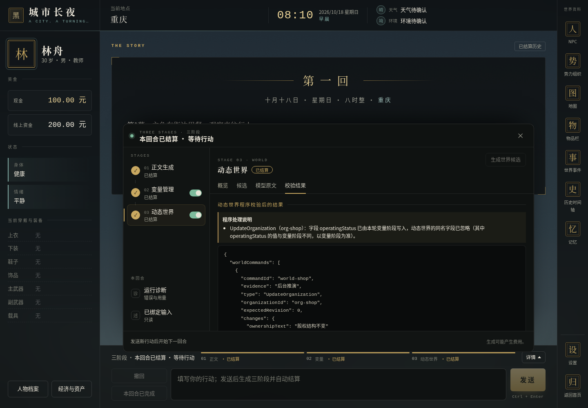
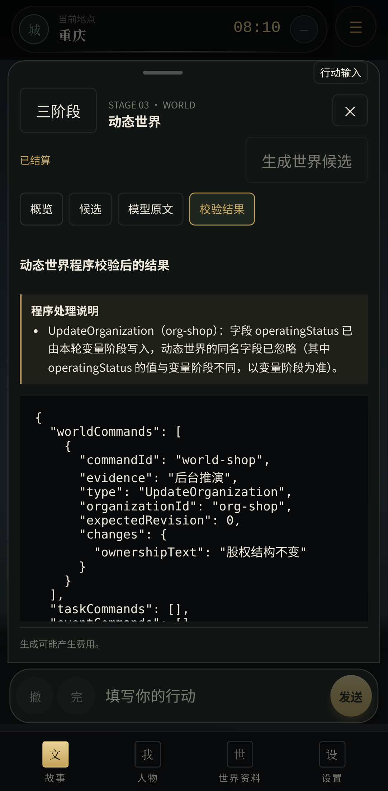
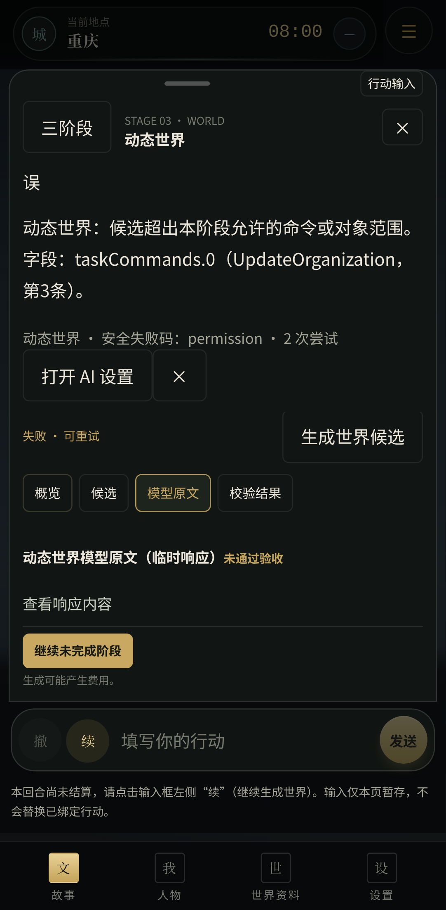

# PR #190 World 冲突剔除安全返修与 Node 24 验收

验收日期：2026-11-18。结论：本轮返修与正式工程验收通过，未发现剩余 P0/P1/P2 阻断，交十五代目再次独立复审。没有合并、部署、更新公告或调用真实付费模型。

## 基线与范围

- 实际 main：`988a7dd6b9515350889df9b14b579e7f00fd4756`；结束前重新 fetch 核对未变。
- 接手 PR HEAD：`76ad8282277ac4bc965d78ca848616cdc604c43e`，原远端分支 `fix/world-scene-write-conflict`。
- 完整阅读 Review `5951449714`、#186 和 PR 原始差异。PR 实际为 Open、非 Draft、未合并，本轮保持其类型与状态。
- main 已是 PR 的祖先，不需要额外合流。没有修改其他工作分支，修复正常推回原分支，不 force push。
- 最终 HEAD 由本报告所在提交及原 PR 本轮验收评论记录。原始证据保存在隔离目录 `/workspace/pr190-evidence`，并随本报告提供证据包。

## 根因与最小修复

三个 World 命令数组在 Schema 层都是 `DomainCommandSchema[]`。原实现先执行冲突过滤，再检查分组、ID 和命令权限。错误分组、重复 ID、仍在场人物的更新，甚至旧 revision 或重复字段中的非法引用，都可能因整条命令被删除而失去检查机会。

本轮保持 #186 的 Variables 优先策略，但调整顺序：

1. 解析原始 `WorldResultSchema`，使用既有 Variables 正式投影。
2. 对原始三个数组检查既有分组白名单：worldCommands 原权限；taskCommands 仅 SaveTask；eventCommands 仅 SaveEvent / DeleteEvent。
3. 对原始命令检查 ID 唯一性（包括与本轮 Variables ID 的冲突）、重复效果及实体写入约束。
4. 保留既有阶段承接规范化，逐条检查原始 NPC、组织、任务、事件权限。
5. 使用原 `projectTurn()` 校验原始候选的完整领域约束，确保即将被剔除的字段也不能掩盖旧 revision、非法引用等问题。
6. 原始候选合法后，仅在 worldCommands 中剔除与 Variables 重复的合法字段或关系命令。原来的金融依据清理、无剩余内容整条忽略策略保持不变。
7. 只有确实发生剔除时，先继续检查保留候选的重复效果，再进行一次原有纯内存投影；后续到期事件、阶段成果、Commit 前重验均使用保留结果。无剔除时复用原投影。

额外投影不产生模型请求或存档写入，不引入第二套解析器、权限或领域规则。先仅移动分组检查不足以保护会被删除的 NPC 授权、revision 和引用，因此保留完整原始领域校验是必要的安全边界。

具体位置：

- [worldOutput.ts](../../src/services/validation/worldOutput.ts)：原始分组及安全约束先检查，再合法剔除；分组错误提供原始位置。
- [worldSceneWrites.ts](../../src/services/validation/worldSceneWrites.ts)：只过滤已验证合法的 worldCommands，不再触碰任务、事件数组。
- [worldProjectionDiagnostics.ts](../../src/services/validation/worldProjectionDiagnostics.ts)：保留原始数组来源，过滤后重验的命令索引仍映射到模型原始位置。此处只调整错误定位，不改变错误脱敏或执行规则。

`commandIndex` 仍为原始三个数组连接后的 0 基索引；`fieldPath` 使用原数组与原局部索引，UI 继续转换为第 N 条。Schema、原始模型文本、AI 请求参数、正式存档与备份协议均未改。

## 先红后绿与安全结果

最初测试构造中有一个世界候选版本未递增的夹具错误，已补齐正式 `candidateRevision`；原日志 `red.log` 保留。随后在未修改生产代码的原 PR 上得到有效红测：22 项中 **14 失败、8 通过**（`red-confirmed.log`），包括非法分组被接受及索引偏移。

最终新增安全文件 [world-scene-write-safety.test.ts](../../src/tests/world-scene-write-safety.test.ts) **24 项全绿**。使用真实 `parseWorld`、正式 Schema、领域投影及 Repository，不只测试过滤辅助函数。

| 场景 | 最终结果 |
| --- | --- |
| 合法重复 UpdateOrganization 在 worldCommands | 忽略重复字段；阶段通过；原始输入与正式状态不变 |
| UpdateOrganization 误入 taskCommands / eventCommands | 原始分组 permission / command_structure 拒绝，即使原本会完全剔除 |
| UpdateNpc / RecordOrgRelation 误入 eventCommands | 原始候选拒绝 |
| 合法重复 + 独立合法字段 + 非法分组混合 | 整批拒绝，不保留 World 部分候选 |
| 原始 World 重复 ID、与 Variables ID 冲突、重复效果 | 均拒绝，不因过滤获豁免 |
| NPC 身份、关系、互动、重新入场及 affinityChange | 均保持原权限拒绝 |
| NPC 仍在场、旧 expectedRevision、缺失目标和非法引用 | 即使字段会被剔除也拒绝；诊断不泄露示例敏感值 |
| 主角命令、错误组织类别字段 | 仍拒绝 |
| 前一条被剔除、后一条权限或领域错误 | fieldPath 与 commandIndex 都指向模型原始第 2 条 |
| 剔除后不同原命令变成相同效果 | 整批拒绝，避免首次验证通过而 Commit 重验拒绝 |
| 过滤后保留字段依赖临时名称覆盖才能成立 | 重验仍拒绝，并正确定位原始第 2 条；未接受不合法投影 |
| Variables 权威组织状态 + World 独立字段 | 正式保存两者的合法组合，Variables 值不被覆盖 |

过滤后重验负例具体构造：Variables 已把第一家组织命名为 A；World 临时把它改为 B，并将第二家组织命名为 A。原始投影可成立，但忽略第一条重复名称后，第二条会造成同类组织重名。阶段必须拒绝，错误仍为 `worldCommands.1` / `commandIndex: 1`，不能因过滤改报第一条。

交付前又补查出一项规范化幂等边界：原命令因重复字段的值不同而效果不同，剔除后可能变成相同效果。新增用例先得到 23 通过 / 1 失败（`post-strip-effects-red.log`），再用四行代码恢复剔除后的既有效果去重检查。原始候选与保留候选均检查，避免返回无法通过 Commit 重验的候选；没有合并或静默去掉重复的独立合法字段。

原有 organization-system、world-validation、world-structural-reliability 的断言均保留，验证了 Variables 新建组织/关系、独立字段、NPC 合法离场、financialBasis 清理等 #186 行为。

## 正式保存与原文保护

新增真实 Repository 用例完成以下链路：

- 按正式草稿版本保存剔除结果；重新读取候选与规范化结果一致。
- `parseWorld` 重验剔除候选得到相同结果，不再生成重复处理说明。
- `commitTurn()` 原子重验后，正式组织状态与正式投影一致；revision 只加一次、Journal 只增一条。
- 同一提交幂等重放返回 `replayed`，没有重复回合；重新读取正式状态一致。
- 原始模型 JSON 文本保持原样；处理说明通过 WeakMap / 临时 StageResponseStore 留存，没有写入正式 GameState。

双端 Chromium 又验证了：原始响应完整可查；校验结果中显示剔除说明；独立合法字段正常结算。错误分组时，正式 GameState 完全不变、World 候选不存在、合法 Variables 保留；查看诊断/原文前后 Repository 相同。玩家明确修正后，只追加一次 World 请求，不重跑 Story/Variables，最终只结算一次。

## 正式环境与全部批次

Node **v24.19.0** / npm **11.9.0** / Vitest **5.0.5** / Playwright **1.64.1** / Chromium **154.0.8037.57**，项目真实锁文件依赖。没有替代运行器。

| 命令或批次 | 通过 / 失败 / 跳过 | 退出码 | 日志 |
| --- | --- | --- | --- |
| `npm_config_cache=/workspace/.npm npm ci` | 安装 143 包成功 | 0 | npm-ci.log |
| 原 PR 有效红测，22 项 | 8 / 14 / 0 | 1 | red-confirmed.log |
| 首轮 `npm run check` | Vitest 4407 / 0 / 0；TypeScript 发现新增测试夹具漏填必需字段 | 2 | check-first.log |
| 补齐夹具后 `npm run check` | 4407 / 0 / 0；Lint、TypeScript、catalog、Build 通过 | 0 | check-final.log |
| 过滤后索引回归的中间完整检查 | 185 文件、4408 / 0 / 0；工程检查通过 | 0 | check-verified.log |
| 最终 `VITEST_MAX_WORKERS=2 npm run check` | **185 文件、4409 / 0 / 0；Lint、TypeScript、文件名、catalog、Build 全通过** | **0** | check-release.log |
| `npm run prompts:check` | **93 / 0 / 0** | **0** | prompts-release.log |
| 最终十文件定向 Vitest | **276 / 0 / 0** | **0** | targeted-release.log |
| 最终新增安全文件单跑 | **24 / 0 / 0** | **0** | safety-release.log |
| 最终 `git diff --check`、暂存区检查 | 通过 | 0 | diff-check.log / staged-diff-check.log |

定向十文件包含：organization-system、world-validation、world-structural-reliability、world-scene-write-safety、world-stage、world-data-boundary、turn-commit、turn-coordinator、automatic-turn、stage-response-observation。

Prompt 93 与专项测试属于完整 Vitest 的重叠集合，不叠加计数。早期 110、274 项等中间批次日志也保留，不与最终 4409 合并为一次全绿。TypeScript 的首轮错误是本轮新测试的构造错误，已补齐 UpdateProtagonist 的 protagonistId / expectedRevision，使该负例真正走 World 权限校验，而不是在通用 Schema 提前失败；没有改生产规则迁就测试。

## 双端 Chromium 与失败归因

仅选择 `automatic-settlement.spec.ts` 中 #186 和 #190 场景，保留项目原 desktop / mobile 配置、Mock 与请求数断言，隔离端口，workers=1，不重跑无关大型套件。

| 浏览器批次 | 通过 / 失败 / 跳过 | 退出码 | 说明 |
| --- | --- | --- | --- |
| 首轮新增测试 | 4 / 2 / 0 | 1 | 手机诊断已自动打开，测试再次点击被原生模态遮挡的底层入口 |
| 第二轮测试导航调整 | 4 / 2 / 0 | 1 | 新定位器未限定活动弹窗，匹配两处 runtime-log，严格定位失败 |
| 导航修正后的整批 | 6 / 0 / 0 | 0 | browser-verified.log，保留中间成功证据 |
| 补强后首批 | 5 / 1 / 0 | 1 | desktop 等待器同时匹配进度状态和原文接收状态，严格定位失败；browser-release.log |
| 最终整批 | **6 / 0 / 0** | **0** | PC 3、手机 3；正例与两种非法分组完整覆盖；browser-accepted.log |
| 干净 main 手机模态对照 | **1 / 0 / 0** | **0** | 同 Node/锁文件/Chromium/原项目配置，证明已有原生模态和两份日志 DOM；关闭模态后可打开原文 |
| 干净 main PC 接收状态对照 | **1 / 0 / 0** | **0** | 同环境证明原文接收中与工作流进度均为 status；正式提交后只剩已结算状态 |

两项新增测试的导航已限定到活动诊断 Dialog，并正常点击关闭后再进入模型原文；恢复时先断言 Repository 已正式推进回合，再检查原有“本回合已结算”状态，以免原文接收中的另一个 status 触发严格定位错误；没有 `.first()`、强制点击、skip、删除或放宽业务断言。最终 E2E 定位调整后另行 ESLint 退出码 0（release-e2e-lint.log）。未修改共享导航助手或正式 UI。首轮和第二轮的日志、错误上下文及 trace 都保留。

同环境 main 对照为 `988a7dd6b9515350889df9b14b579e7f00fd4756`，临时测试源码为证据包 `main-modal-proof.spec.ts.txt`、`main-status-proof.spec.ts.txt`；正式 main 工作树测试后恢复干净。这些失败属于本轮新增测试对既有模态行为的导航/定位错误，不是生产权限修复引入的回归。没有借用作者 Node 22 环境的旧失败归因，也没有宣称未运行的其他旧 E2E 已通过。

PC、手机各三个最终场景：

1. #186 合法重复字段被剔除、独立字段保留、原文不变、诊断说明正确、正式结算成功。
2. #190 taskCommands 非法重复组织命令，混合批次拒绝；原文和正式状态受保护，主动修正后仅恢复 World。
3. #190 eventCommands 同类安全负例与主动恢复。

另附 PC 与手机两个错误分组截图，共六张。最终单批日志：browser-accepted.log；原始失败：browser.log、browser-final.log、browser-release.log；main 对照：main-browser.log、main-status-browser.log。

## 本轮修改文件

| 文件 | 改动 |
| --- | --- |
| src/services/validation/worldOutput.ts | 调整原始验证、过滤、重投影的顺序；原始分组诊断 |
| src/services/validation/worldSceneWrites.ts | 仅过滤合法 worldCommands |
| src/services/validation/worldProjectionDiagnostics.ts | 过滤后诊断保留原始位置 |
| src/tests/world-scene-write-safety.test.ts | 24 项安全及 Repository 回归 |
| e2e/automatic-settlement.spec.ts | 新增两种分组负例与主动恢复；活动诊断导航 |
| docs/pr190-world-safety/REPORT.md、evidence.zip、screenshots/*.png | 本报告、全部日志/trace 和六张真实截图 |

原 PR 已有的 Prompt、AI 请求、领域 Schema、GameState、IndexedDB、备份、存档事务、Commit、Undo 和其他原测试断言没有被本轮修改。没有更新公告，没有操作玩家存档。

## 剩余限制与结论

- 本轮是 Mock 工程验收，不验证真实供应商实际生成质量，不调用收费 API。
- Chromium PC/手机通过；没有真实 iPhone Safari 或 WebKit 验证。本次不改 CSS 和触摸交互。
- 发生合法剔除时多一次纯内存领域投影；本轮未进行超大真实存档性能专项，不改变正式写入次数。
- Build 只有既有的大于 500 kB chunk 提示，退出码 0；未顺便重构拆包。
- GitHub status 接口未返回检查项，无法据此独立确认新 HEAD 的 Cloudflare Preview；本地 Build 已通过，不以 Preview 或合并状态冒充生产验收。

**最终结论：本次要求的功能与权限保护同时通过，未发现剩余 P0/P1/P2 阻断。等待十五代目重新独立复审及作者授权，保持 PR Open、未合并。**

[原始日志、Review、复现脚本和所有失败 trace](evidence.zip)
