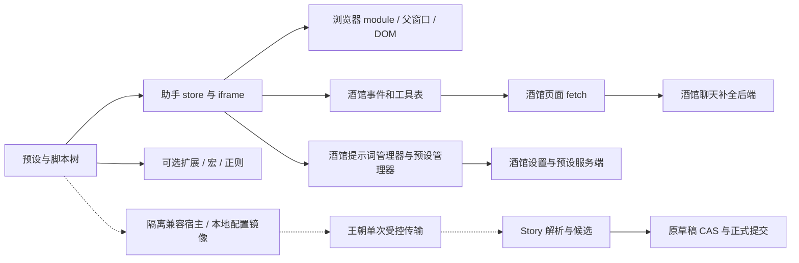

# 静态审计与依赖图

实线表示固定源码中的依赖，虚线表示提议的王朝接入。图中两个网络入口很重要：酒馆网页请求自己的后端，王朝浏览器从自己的客户端发送到所选渠道。只替换子页面的 fetch 无法接管这两者。

### 1. 从包到可用实例

助手从预设管理器读扩展字段，切预设监听器优先更新身份；修改时同步当前 oai_settings，并另行防抖保存命名预设。导出可按 export_with 去掉按钮或脚本数据。目录类型只有脚本或含脚本数组的文件夹。全局、当前预设、角色各有来源开关，文件夹与子脚本均要启用；app_ready 后按脚本 ID 排序生成实例。重新加载有新的 reload_memo。按钮还要检查组启用与按钮可见。[H·preset.ts L8](https://github.com/N0VI028/JS-Slash-Runner/blob/c13105d6e2abd2871a4b77f0e7251869dd840a3f/src/store/settings/preset.ts#L8) [H·scripts.ts L18](https://github.com/N0VI028/JS-Slash-Runner/blob/c13105d6e2abd2871a4b77f0e7251869dd840a3f/src/type/scripts.ts#L18) [H·scripts.ts L83](https://github.com/N0VI028/JS-Slash-Runner/blob/c13105d6e2abd2871a4b77f0e7251869dd840a3f/src/store/scripts.ts#L83) [H·script.ts L15](https://github.com/N0VI028/JS-Slash-Runner/blob/c13105d6e2abd2871a4b77f0e7251869dd840a3f/src/store/iframe_runtimes/script.ts#L15) [H·Script.vue L49](https://github.com/N0VI028/JS-Slash-Runner/blob/c13105d6e2abd2871a4b77f0e7251869dd840a3f/src/panel/Script.vue#L49)

实例是隐藏 iframe，通过 srcdoc 或 blob 创建 module。parent_jquery、predefine 和第三方资源先于脚本加载；predefine 复制父域全局，去除下划线的实例 API 绑定该 iframe 的 window；缓存 iframe 身份供移除 DOM 后使用。getContext 为浅展开，嵌套配置可共享。pagehide 清理事件；blob URL 更换或卸载时回收。脚本自建的定时器、工具与 fetch wrapper 仍须分别释放。上游可选 cleanup protector 按内容中是否含 pagehide 作选择，不能充当撤权依据。[H·Iframe.vue L1](https://github.com/N0VI028/JS-Slash-Runner/blob/c13105d6e2abd2871a4b77f0e7251869dd840a3f/src/panel/script/Iframe.vue#L1) [H·iframe.ts L5](https://github.com/N0VI028/JS-Slash-Runner/blob/c13105d6e2abd2871a4b77f0e7251869dd840a3f/src/panel/script/iframe.ts#L5) [H·predefine.js L1](https://github.com/N0VI028/JS-Slash-Runner/blob/c13105d6e2abd2871a4b77f0e7251869dd840a3f/src/iframe/predefine.js#L1) [H·parent_jquery.js L1](https://github.com/N0VI028/JS-Slash-Runner/blob/c13105d6e2abd2871a4b77f0e7251869dd840a3f/src/iframe/parent_jquery.js#L1)

### 2. 从输入到一次出站

酒馆从原生 prompts 和 prompt_order 组装当前配置，助手读取时转换成有序 prompts 和未使用项，顺序项的 enabled 优先。宏、世界信息与历史参与组装；Generate 会发送 GENERATE_AFTER_DATA 并可在 dryRun 提前返回。工具定义由 ToolManager 按条件加入，申请参数与模型、生成类型相关。最终 await CHAT_COMPLETION_SETTINGS_READY 暴露可变的**酒馆生成参数对象**，其后才序列化并发往 /api/backends/chat-completions/generate。服务端再选择上游、转换格式及转发流。[H·preset.ts L346](https://github.com/N0VI028/JS-Slash-Runner/blob/c13105d6e2abd2871a4b77f0e7251869dd840a3f/src/function/preset.ts#L346) [S·script.js L5318](https://github.com/SillyTavern/SillyTavern/blob/7e8663cd9c184a550b37238218bdd32c6efc68e9/public/script.js#L5318) [S·tool-calling.js L400](https://github.com/SillyTavern/SillyTavern/blob/7e8663cd9c184a550b37238218bdd32c6efc68e9/public/scripts/tool-calling.js#L400) [S·openai.js L2840](https://github.com/SillyTavern/SillyTavern/blob/7e8663cd9c184a550b37238218bdd32c6efc68e9/public/scripts/openai.js#L2840) [S·openai.js L3146](https://github.com/SillyTavern/SillyTavern/blob/7e8663cd9c184a550b37238218bdd32c6efc68e9/public/scripts/openai.js#L3146) [S·chat-completions.js L2242](https://github.com/SillyTavern/SillyTavern/blob/7e8663cd9c184a550b37238218bdd32c6efc68e9/src/endpoints/backends/chat-completions.js#L2242)

助手自己的 generate/generateRaw 还有生成请求、开始、停止、结束通知；分支可能直接使用 generate 端点，也可能临时注册 optionsInjector 后调用酒馆 sendOpenAIRequest，并在 finally 恢复。非同一条事件不能一律当作 awaited。助手按版本动态导入 createGenerationParameters，有 fallback，显式工具可覆盖自动注册；1.19.0 存在预期函数，宿主 context 暴露实际 ToolManager。静态形状匹配只支持进入原型。[H·index.ts L325](https://github.com/N0VI028/JS-Slash-Runner/blob/c13105d6e2abd2871a4b77f0e7251869dd840a3f/src/function/generate/index.ts#L325) [H·responseGenerator.ts L341](https://github.com/N0VI028/JS-Slash-Runner/blob/c13105d6e2abd2871a4b77f0e7251869dd840a3f/src/function/generate/responseGenerator.ts#L341) [H·responseGenerator.ts L599](https://github.com/N0VI028/JS-Slash-Runner/blob/c13105d6e2abd2871a4b77f0e7251869dd840a3f/src/function/generate/responseGenerator.ts#L599) [H·createGenerationParametersCompat.ts L11](https://github.com/N0VI028/JS-Slash-Runner/blob/c13105d6e2abd2871a4b77f0e7251869dd840a3f/src/function/generate/createGenerationParametersCompat.ts#L11) [S·openai.js L2691](https://github.com/SillyTavern/SillyTavern/blob/7e8663cd9c184a550b37238218bdd32c6efc68e9/public/scripts/openai.js#L2691) [S·st-context.js L183](https://github.com/SillyTavern/SillyTavern/blob/7e8663cd9c184a550b37238218bdd32c6efc68e9/public/scripts/st-context.js#L183)

### 3. 入站与候选

酒馆区分整份 JSON 和 SSE；流处理 reader、DONE、错误、累计文本及工具增量。助手另有增量/全量文本和 reasoning 事件。转换后的 Response 可有自己的结束标记。王朝 main 的 AiClient 走实际渠道与凭证，区分 SSE 与整份 JSON；readSse 单 reader、严格 UTF-8、识别 EOF 残尾。runtime 组装冻结输入、调用客户端、解析 Story Envelope。StoryStage 结合请求依据、Schema 和凭证回显检查，写带版本条件的候选；协调器和 automaticTurn 后续才走 commitTurn。关闭阶段、合法断点续写、主动取消都继续由原生工作流决定。格式尾在 composer 中单独组装。旧架构文档有“三协议”表述，以当前 wireRequest 的 OpenAI、DeepSeek、Gemini、Anthropic 分支为准。[S·openai.js L3160](https://github.com/SillyTavern/SillyTavern/blob/7e8663cd9c184a550b37238218bdd32c6efc68e9/public/scripts/openai.js#L3160) [H·responseGenerator.ts L119](https://github.com/N0VI028/JS-Slash-Runner/blob/c13105d6e2abd2871a4b77f0e7251869dd840a3f/src/function/generate/responseGenerator.ts#L119) [G·protocols.ts L61](https://github.com/WJT111222/HeiJinWangChao/blob/0bdffc9d39b231b9b69a83181d979525e104fca9/src/services/ai/protocols.ts#L61) [G·client.ts L150](https://github.com/WJT111222/HeiJinWangChao/blob/0bdffc9d39b231b9b69a83181d979525e104fca9/src/services/ai/client.ts#L150) [G·sse.ts L2](https://github.com/WJT111222/HeiJinWangChao/blob/0bdffc9d39b231b9b69a83181d979525e104fca9/src/services/ai/sse.ts#L2) [G·runtime.ts L102](https://github.com/WJT111222/HeiJinWangChao/blob/0bdffc9d39b231b9b69a83181d979525e104fca9/src/services/ai/runtime.ts#L102) [G·runtime.ts L156](https://github.com/WJT111222/HeiJinWangChao/blob/0bdffc9d39b231b9b69a83181d979525e104fca9/src/services/ai/runtime.ts#L156) [G·storyStage.ts L173](https://github.com/WJT111222/HeiJinWangChao/blob/0bdffc9d39b231b9b69a83181d979525e104fca9/src/workflows/storyStage.ts#L173) [G·automaticTurn.ts L6](https://github.com/WJT111222/HeiJinWangChao/blob/0bdffc9d39b231b9b69a83181d979525e104fca9/src/workflows/automaticTurn.ts#L6) [G·saveRepository.ts L561](https://github.com/WJT111222/HeiJinWangChao/blob/0bdffc9d39b231b9b69a83181d979525e104fca9/src/services/storage/saveRepository.ts#L561) [G·composer.ts L123](https://github.com/WJT111222/HeiJinWangChao/blob/0bdffc9d39b231b9b69a83181d979525e104fca9/src/prompts/composer.ts#L123)

### 4. 1118 私有样本

行号从解析后对应 content 字符串第一行起算，大小按 UTF-8 编码。表中是静态依赖和阻断，不是运行成绩。

| 单元 | 计数与调用证据 | 激活、降级和验证边界 |
| --- | --- | --- |
| 主脚本 scripts[0] | 168,497 B、2,931 行，一个可见按钮。333–368 检查生成对象；566–697 获取 runtime/parent/top context、注册后回查工具对象，订阅末位 READY、生成/停止、切档切预设事件。2918–2929 两个独立启动块；一块失败并不保证另一块停止。 | 早于完整能力检查即可注册状态按钮。缺 API、同名工具、生成类型/多候选、调用能力、消息类型或资料边界不符时，可报错、跳过或回退。shouldRegister 返回 false 的注册对象可作为身份标记，事件处理器另行改写工具声明。测试须看到最终请求确实走目标分支。 |
| 主脚本入站/网络 | 1298–1342 包装并恢复宿主 fetch；1539–1679、2624–2788 存在输出模式选择、JSON/SSE 改写、合成结束及文本恢复分支。界面依赖父域、storage、jQuery、通知。 | 上下游请求对象克隆会影响跟踪；必须记录原始流与转换流各自的来源。最长片段、脚本合成 DONE、样本自报成功均不足以准入正式候选。涉及请求扰动的分支不列入支持；不能隔离时整份主脚本停留在受限实验台。 |
| 控制台 scripts[1] | 591,492 B、940 行，预设按钮数组为空。12–52、95–154 读取父 DOM、storage、预设归一化副本和脚本变量；503–559 检查身份后修改原生 prompts 与 100001 顺序行，排队保存，调用有正确接收者的 manager.render，失败有局部撤销。852–939 自建 UI、指针/视口监听、卸载清理。 | 可见 UI 不证明可保存。须分开验证版本冲突、重开后的设置与下一请求。668–715 估算依赖 chat 身份、GENERATE_AFTER_DATA、generate(...,true)、输入框和 getTokenCountAsync；缺其一显示不可用。估算单独要求零传输。私域父页面映射/局部 storage、UI 导入导出、字体资源是独立兼容项。 |
| 整包 prompts | 1,650,746 B 文件；164 个唯一提示项（163 system、1 assistant，8 个 marker）。条目 enabled 为真 97 个；100001 顺序表 163 行，启用 87 行；13 行与条目 enabled 不同。两脚本位于树根，均 enabled；预设变量与两份初始脚本 data 都为空。 | “87 行”不等于发出 87 条消息；需考虑 marker、角色、注入位置与条件。原始 JSON 与归一化视图分存。自写夹具检查未排入项、排序、缺 ID 和覆盖优先级。 |
| 宏、正则与其他扩展 | 仅对 prompts.content 的双花括号起始词法计数：random 1,358、setvar 326、getvar 126、user 1；不代表执行次数。regex_scripts 有 12 条启用的 placement 2 规则，9 条仅显示、3 条仅提示，均 runOnEdit，一条 minDepth=4。七条替换文本包含 script 标签。SPreset 的 12 份绑定与主列表 ID 集相同，6 份替换文本不同。baibaiToolkit 另有分组元数据。 | 不得双跑两套正则或把显示替换注入主 DOM。SPreset 含关闭的压缩、预处理、最终处理等配置；LogUpload 的开关为真但 URL 为空，不据此推断发生上传。样本含外部字体地址、内嵌资源与动态查找；未请求任何资源。宏嵌套、别名、实际插件加载顺序及激活条件待验证。 |

控制台依赖上游 getPreset 的克隆语义及 chatCompletionSettings 的共享引用，二者不能合并。saveSettingsDebounced 更新当前设置；命名预设文件另有 savePreset 端点。render(false) 调度视图，默认 render() 还可能触发 dry run。页面重绘不证明落盘成功。[H·preset.ts L588](https://github.com/N0VI028/JS-Slash-Runner/blob/c13105d6e2abd2871a4b77f0e7251869dd840a3f/src/function/preset.ts#L588) [H·preset.ts L625](https://github.com/N0VI028/JS-Slash-Runner/blob/c13105d6e2abd2871a4b77f0e7251869dd840a3f/src/function/preset.ts#L625) [H·builtin.ts L18](https://github.com/N0VI028/JS-Slash-Runner/blob/c13105d6e2abd2871a4b77f0e7251869dd840a3f/src/function/builtin.ts#L18) [S·PromptManager.js L862](https://github.com/SillyTavern/SillyTavern/blob/7e8663cd9c184a550b37238218bdd32c6efc68e9/public/scripts/PromptManager.js#L862) [S·preset-manager.js L473](https://github.com/SillyTavern/SillyTavern/blob/7e8663cd9c184a550b37238218bdd32c6efc68e9/public/scripts/preset-manager.js#L473) [S·script.js L8051](https://github.com/SillyTavern/SillyTavern/blob/7e8663cd9c184a550b37238218bdd32c6efc68e9/public/script.js#L8051)

**尚未核实**：两个固定上游版本加私有包能否原样启动；间接调用、动态模块和外部扩展具体生效顺序；两个脚本共同运行的身份与清理；真实页面成本。只从附件静态读取，不用旧样本补全这些证据。

#198 合入后，StoryStage 的显式旧通知恢复还需玩家选择、授权和特定阶段组合，保存走 saveRecoveredStory。兼容脚本不能自行生成选择或恢复授权；B 使用合成只读投影，D 对普通与恢复两条路径分别验证。[StoryStage](https://github.com/WJT111222/HeiJinWangChao/blob/0bdffc9d39b231b9b69a83181d979525e104fca9/src/workflows/storyStage.ts#L97) [专用保存入口](https://github.com/WJT111222/HeiJinWangChao/blob/0bdffc9d39b231b9b69a83181d979525e104fca9/src/services/storage/saveRepository.ts#L691)
